# Практический гайд: шесть маршрутов

Шесть разных процессов, которые вместе показывают все возможности плагина
1.13.2. Каждый процесс — от формы до решённой заявки: что настроить, кто что
делает и как это выглядит на экране. Все названия, люди и системы
вымышленные — подставьте свои.

Первый знакомый шаг — [учебник](TUTORIAL.md): один маршрут по шагам. Что
значит каждое поле — [справка](REFERENCE.md). Сводная таблица «функция →
процесс» — [в конце](#функция--процесс).

| № | Процесс | Что в нём главное |
|---|---|---|
| 1 | [Рабочее место новому сотруднику](#1-рабочее-место-новому-сотруднику) | запуск по форме, согласование из формы, условие по вопросу этапа и дате, дочерняя заявка |
| 2 | [Доступ к системе](#2-доступ-к-системе) | два маршрута одной формы, перенос копией, уточнение у инициатора, согласующий по выбору |
| 3 | [Пропуск для гостя](#3-пропуск-для-гостя) | срок в часах и просрочка, запуск вручную, «Выполнять этап?», отзыв заявки |
| 4 | [Ремонт оборудования](#4-ремонт-оборудования) | бизнес-правило, условие по категории, передача и пропуск этапа, остановка и новая попытка |
| 5 | [Покупка программы](#5-покупка-программы) | условия по числу и файлу, «Каждый в группе», отказ с причиной, согласование в дочерней заявке |
| 6 | [Плановые работы](#6-плановые-работы) | маршрут для изменения, право на согласование, «Прервать маршрут…», «Закрыть принудительно…» |

## Подготовка

Всё, кроме маршрутов, создаётся штатно в GLPI.

**Плагин.** Установлен по [INSTALL.md](INSTALL.md); системный cron GLPI
работает, автоматические действия «Сроки этапов» (`itilflow_deadlines`)
и `itilflow_status_sync` включены.

**Организация «Пример»** и группы в ней. У каждой группы в «Отображать
в заявке» → «Назначено» — «Да», иначе её нет в списке этапа.

| Группа | Кто в ней | Где работает |
|---|---|---|
| Служба поддержки | специалист поддержки | процессы 1, 2, 5, 6 |
| Склад оборудования | тот же специалист | процесс 1 |
| Закупки | специалист по закупкам | процессы 1, 4, 5 |
| Ресепшен | администратор ресепшена | процесс 3 |
| Охрана | начальник охраны | процесс 3 |
| Сервисные инженеры | два инженера | процесс 4 |
| Комиссия | руководитель, владелец системы, начальник охраны | процесс 5 |
| Совет по изменениям | владелец системы, специалист поддержки, инженер | процесс 6 |

**Люди.** Инициатор, его руководитель, начальник охраны — профиль
самообслуживания. Специалисты, инженеры, закупки, ресепшен и владелец
системы — профиль центрального интерфейса в «Пример». Администратор
маршрутов — свой профиль центрального интерфейса.

**Права плагина.** **Администрирование → Профили → ‹профиль› → «Маршруты
этапов».** Администратору маршрутов — «Чтение», «Обновление», «Создать»
(нужно для импорта) и «Очистить». Дежурному администратору, который
закрывает без ответа любой этап, — ещё строка «Закрытие этапа без ответа» →
«Закрыть принудительно». Исполнителям и согласующим права плагина не нужны —
только права GLPI ([RIGHTS.md](RIGHTS.md)). Пункт меню «Маршруты этапов»
появится после повторного входа.

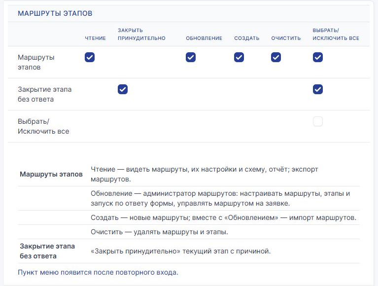

**Прочее.** Этап согласования GLPI «Согласование руководителя» (**Настройки →
Выпадающие списки**). Категория «Ремонт оборудования» с подкатегориями
«Компьютер» и «Принтер». Рабочий календарь — штатный «Default».

Проверяйте каждый процесс под его участниками, а не под администратором:
кнопку видит только тот, кто может выполнить действие.

---

## 1. Рабочее место новому сотруднику

**Зачем.** Руководитель подтверждает выход сотрудника, склад сверяет заказ
с нормой, недостающее закупают, служба поддержки готовит рабочее место.
Если сотрудник выходит раньше, чем придёт закупка, ему выдают подменный
компьютер.

**Форма «Пример: рабочее место новому сотруднику».** «ФИО сотрудника» (короткий
ответ), «Дата выхода» (дата), «Что нужно» (флажки: «Компьютер», «Монитор»,
«Телефон», «Гарнитура»), «Руководитель» (пользователь), «Комментарий».
Назначение «Заявка»: группа «Служба поддержки», согласование — ответ
«Руководитель», этап согласования «Согласование руководителя».

| № | Этап | Как выполняется | Кто | Особое |
|---|---|---|---|---|
| 10 | Согласование руководителя | Согласование | руководитель из формы | «Согласование из формы» |
| 20 | Проверить по норме | Задача | Склад оборудования | вопрос этапа «Всё есть на складе?», срок 1 рабочий день |
| 25 | Выдать подменный компьютер | Задача | Склад оборудования | если 20 — «нет» **и** дата выхода раньше, чем через 5 дней |
| 30 | Закупить недостающее | Дочерняя заявка | Закупки | если 20 — «нет» |
| 40 | Подготовить рабочее место | Задача | Служба поддержки | отчёт обязателен, срок 2 рабочих дня |

### Настройка

1. **Администрирование → Маршруты этапов → Добавить.** Название, организация
   «Пример», «Рабочий календарь» — «Default». Сроки этапов теперь считаются
   в рабочих часах календаря: у «Default» рабочий день — 12 часов, поэтому
   этап, начатый в воскресенье, получит срок на вторник. «Подчинённые
   организации» — «Да», если маршрут нужен и филиалам.
2. «Добавить» — строка готовности: «Не готов к запуску: 1 проблема · Нет ни
   одного этапа.».
3. «Запуск маршрута»: «Форма» — эта форма, «Сохранить»; «Назначение формы» —
   ««Заявка» — создаётся всегда»; «Запускать, если» — «Всегда».
4. Этап 10: «Согласование», «Кто согласует» — «Согласование из формы», «Этап
   согласования в форме» — «Согласование руководителя».
5. Этап 20: «Задача», группа «Склад оборудования», «Срок этапа» — 1 рабочий
   день, «Вопросы этапа» → «+ Добавить вопрос» → «Всё есть на складе?».
6. Этап 25: «Задача», та же группа. «Когда выполнять» — «Только если выполнены
   условия», «Нужны» — «все условия»:
   - условие 1 — «20. Проверить по норме — «Всё есть на складе?»» — «нет»;
   - условие 2 — «Дата выхода» — «раньше, чем через» 5 «дн. после подачи».

   В «Дополнительно» → «Порядок» поставьте 25: этап встанет между 20 и 30.

   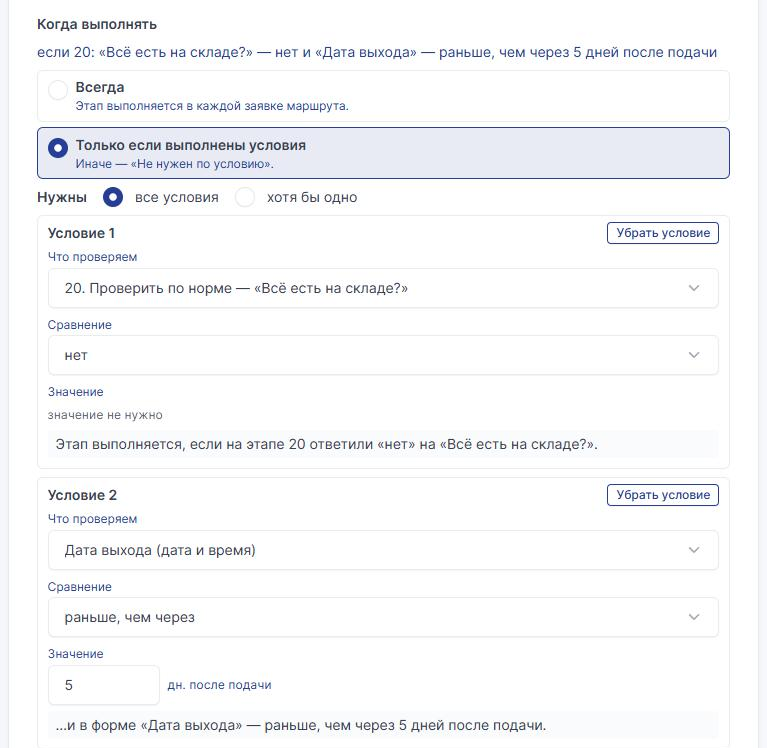

7. Этап 30: «Дочерняя заявка», «Группа отдела» — «Закупки», «Где создать
   дочернюю заявку» — «В организации основной заявки», «Как отдел сообщает
   результат» — «Исполнитель отмечает результат». Условие — «20: «Всё есть
   на складе?» — нет».
8. Этап 40: «Задача», «Служба поддержки», «Отчёт при завершении» —
   «Обязательно», срок 2 рабочих дня.

Строка готовности: «Готов к запуску · 5 этапов · запускается по ответу формы
«Пример: рабочее место новому сотруднику»». «Что дальше» внизу формы этапа
сразу показывает, куда маршрут пойдёт после этапа и как сюда попадают, —
без сохранения.

В «Дополнительно» маршрута оставьте как есть: «Решить заявку — только после
всех этапов» — «Да», «Писать ход этапов в ленту заявки» — «Да» (последнее «Что
сделано» станет решением), «Вкладка маршрута у инициатора» — «Да».

### Как это выглядит

**Инициатор** отправляет форму: дата выхода — через три дня, «Компьютер»,
«Монитор», «Гарнитура», руководитель — свой. На вкладке «Маршрут этапов
0/5» этап 10 — «Сейчас», остальные — «Впереди».

**Руководитель** (самообслуживание) открывает заявку → строка 10 → «Одобрить
или отказать» → комментарий → «Одобрить». Этап 10 — «Согласовано»,
комментарий виден в строке и в листе согласования.

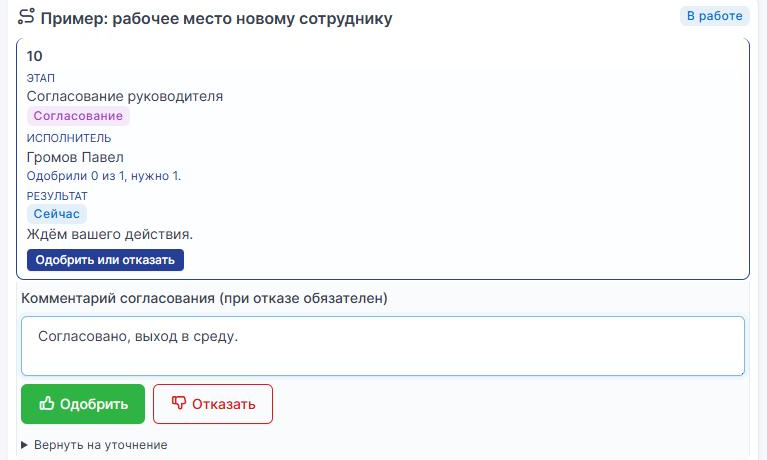

**Склад** — строка 20 → «Завершить этап»: «Всё есть на складе?» — «Нет»,
«Что сделано». Оба условия этапа 25 выполнены — склад выдаёт подменный
компьютер и закрывает этап 25.

**Закупки** получают дочернюю заявку «Закупить недостающее — к заявке №…».
Вкладка «Результат отдела» → «Отметить результат» → «Ответ инициатору» →
«Выполнено». Дочерняя заявка решается сама, в основной начинается этап 40.

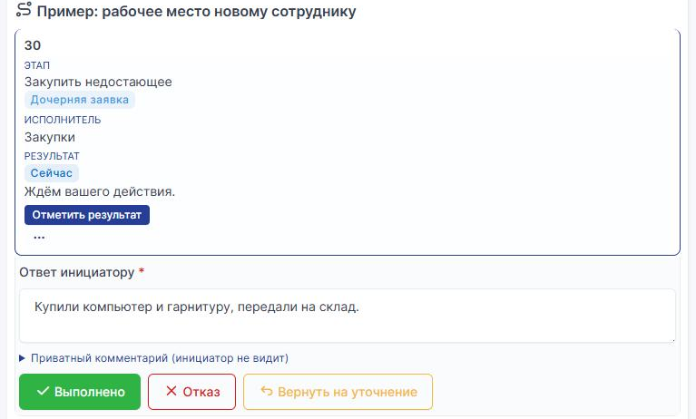

**Служба поддержки** закрывает этап 40 с отчётом. Заявка решается сама:
«Заявка выполнена: все этапы маршрута «…» пройдены. Результат: ‹отчёт этапа
40›». Инициатор принимает решение, как обычно. Шапка вкладки у сотрудников:
«Все этапы пройдены, заявка решена.», «Нужно пройти: 5 из 5 этапов.», кнопка
«Лист согласования» — печатная сводка по этапам ([пример в
учебнике](TUTORIAL.md#шаг-15-вкладка-у-администратора-маршрутов)).

Если бы на складе всё было, этапы 25 и 30 стали бы «Не нужен по условию»:
ничего не создают, маршрут идёт сразу к 40.

---

## 2. Доступ к системе

**Зачем.** Доступ к «Учёту заказов» согласует его владелец, к остальным
системам — владелец, которого выбирает служба поддержки. Одна форма, два
маршрута. Владелец может вернуть заявку на уточнение.

**Форма «Пример: доступ к системе».** «Система» (список: «Учёт заказов»,
«Портал клиентов», «Архив документов»), «Права» (радио: «Только чтение»,
«Изменение»), «Зачем нужен доступ» (долгий ответ). Назначение «Заявка» —
группа «Служба поддержки».

**Маршрут «Пример: доступ к учёту заказов»:**

| № | Этап | Как выполняется | Кто | Особое |
|---|---|---|---|---|
| 10 | Согласование владельца системы | Согласование | владелец — пользователь | вопрос этапа «Нужна новая учётная запись?»; можно вернуть на уточнение |
| 20 | Создать учётную запись | Задача | Служба поддержки | если 10 — «да» |
| 30 | Выдать права | Задача | Служба поддержки | отчёт обязателен |

**Маршрут «Пример: доступ к другим системам»** — те же этапы, но этап 10 —
«Указывает исполнитель заявки».

### Настройка

1. Первый маршрут: «Запуск маршрута» → форма, назначение «Заявка»,
   «Запускать, если» — «Только если выполнены условия»; «Система» — «любой
   из» — «Учёт заказов». Под условием — фраза: «Маршрут запускается, если
   в форме «Система» — Учёт заказов.».
2. Этап 10: «Согласование», «Кто согласует» — «Задан в этапе», «Согласующие —
   пользователи» — владелец системы. «Что проверить согласующему» — что
   смотреть. «Куда вернуть после уточнения» — отмечен этот этап. Вопрос этапа
   «Нужна новая учётная запись?».
3. Этапы 20 и 30. Строка готовности: «Готов к запуску · 3 этапа · …» и под ней
   подсказка «… нет заместителя» — у владельца не задан заместитель
   на время отпуска (настраивается в GLPI).
4. Пока второго маршрута нет, внизу блока «Запуск маршрута» — «если «Система» —
   «Портал клиентов» … не запускается ни один маршрут — заявка останется без
   маршрута». Это пробел: такие заявки останутся у группы назначения.

**Второй маршрут — копией первого.** Список маршрутов → отметьте первый →
«Действия» → «Экспорт» (или «Экспорт всех» над списком) — получите файл JSON.
Затем «Импорт маршрутов» → этот файл → «Предварительный просмотр импорта»:

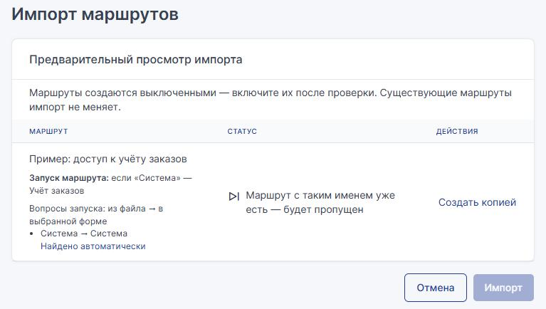

«Создать копией» → «Нужно выбрать: 1» → «Устранять проблемы»: «Назначение
формы» выберите из списка («Заявка»), вопрос «Система» нашёлся сам →
«Предварительный просмотр импорта» → «Готов к импорту · Выбрано вручную: 1.» →
«Импорт». Копия «… (копия)» создана **выключенной**. Откройте её:
переименуйте, в «Запускать, если» отметьте «Портал клиентов» и «Архив
документов», в этапе 10 — «Указывает исполнитель заявки», включите маршрут.

Теперь у обоих маршрутов в «Запуск маршрута» — «Другие маршруты этой формы»,
а пробела нет. Если бы условия пересеклись, маршрут стал бы «Не готов».

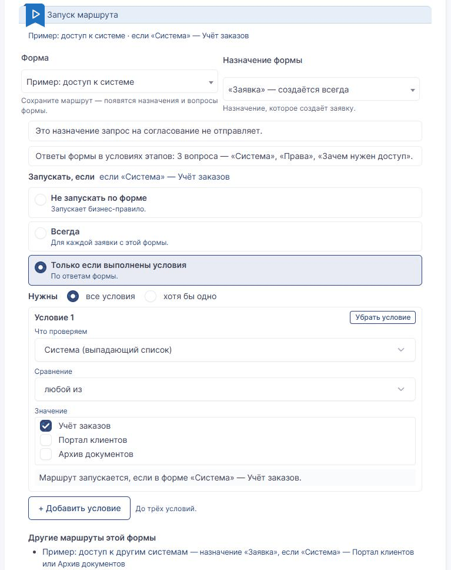

Так же маршрут переносят в другую установку GLPI — [TRANSFER.md](TRANSFER.md).

### Как это выглядит

**Учёт заказов.** Инициатор выбирает «Учёт заказов», «Изменение». Владелец
открывает строку 10 → «Одобрить или отказать» → «Вернуть на уточнение» →
«Что уточнить у инициатора» → «Вернуть на уточнение».

Инициатор видит в шапке «Ответьте комментарием в заявке. Вопрос: «…»» и в
строке «Ждём вашего ответа»:

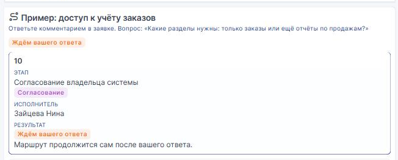

Инициатор отвечает **публичным комментарием** в заявке («Ответ»). Маршрут
продолжается сам: этап 10 открывается заново (попытка 2), владелец получает
новый запрос. Ответ письмом тоже продолжает маршрут, если письмо пришло через
сборщик почты GLPI. Если ответ сразу не учтён, его догонит «Сроки этапов».

Владелец в центральном интерфейсе нажимает «Вопросы этапа», отвечает
«Нужна новая учётная запись?» — «Да» → «Сохранить и одобрить». Этап 20
выполняется, затем 30; заявка решается сама.

> **Важно.** На вопросы этапа согласования отвечает согласующий в центральном
> интерфейсе. В самообслуживании у него только «Одобрить или отказать»: после
> одобрения этап покажет «Ждём ответы на вопросы этапа.», и ответы сохранит
> администратор маршрутов («Вопросы этапа» → «Сохранить ответы»). Если ваши
> согласующие работают в самообслуживании, не задавайте вопросы этапу
> согласования — ставьте их у задачи.

**Портал клиентов.** Этап 10 ждёт: «Согласующего укажет исполнитель». Служба
поддержки нажимает «Указать согласующего», выбирает владельца портала
и пишет причину:

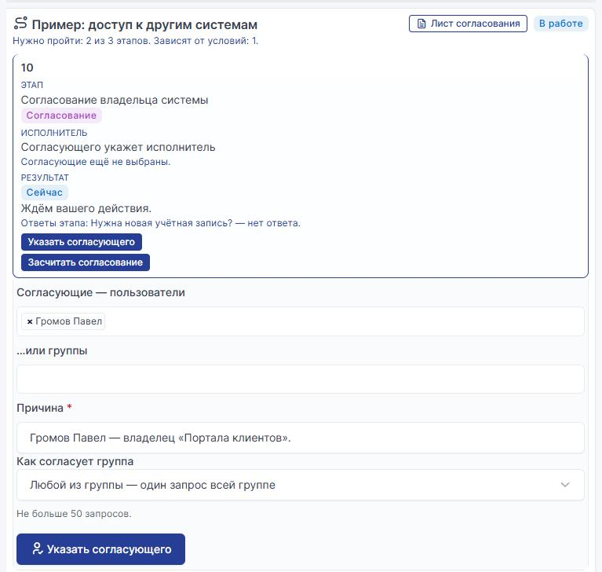

Если согласование уже есть в заявке (например, его запросили вручную),
вместо этого — «Засчитать согласование» с причиной.

---

## 3. Пропуск для гостя

**Зачем.** Ресепшен оформляет пропуск за час. Гостя, который приходит впервые,
согласует охрана. Если гость на машине — ресепшен бронирует место на
парковке. Если визит отменили, инициатор сам отзывает заявку.

**Форма «Пример: пропуск для гостя».** «ФИО гостя», «Дата визита», «Гость
на машине» (радио «Да» / «Нет»), «Номер машины». Назначение «Заявка» —
группа «Ресепшен».

| № | Этап | Как выполняется | Кто | Особое |
|---|---|---|---|---|
| 10 | Оформить пропуск | Задача | Ресепшен | срок 1 рабочий час; вопрос «Гость впервые?»; отчёт обязателен |
| 20 | Согласование охраны | Согласование | группа «Охрана», «Любой из группы» | если 10 — «да» |
| 30 | Место на парковке | Задача | Ресепшен | если в форме «Гость на машине» — «Да»; ответа нет — спросить исполнителя |

### Настройка

1. Маршрут без «Рабочего календаря» — сроки считаются круглосуточно.
   «Запускать, если» — «Всегда». В «Дополнительно» — «Вкладка маршрута
   у инициатора» — «Да», «Инициатор может отозвать заявку» — «Да».
2. Этап 10: «Срок этапа» — 1, «рабочих часов». «Статус заявки на этапе» —
   «В работе (назначена)»: статус поставит `itilflow_status_sync`.
3. Этап 20: «Согласование», «Или согласующие группы» — «Охрана», «Как
   согласует группа» — «Любой из группы»: один запрос всей группе, ответит
   любой. Условие — «10: «Гость впервые?» — да».

   Почему не по дате визита из формы? Строка готовности подсказывает:
   согласование, которое отключается ответом инициатора, лучше ставить
   по вопросу этапа — его задаёт ресепшен, а не инициатор.
4. Этап 30: условие «Гость на машине» — «любой из» — «Да». «Если ответа
   нет» — «спросить исполнителя заявки». Строка готовности напомнит: вариант
   «Нет» не ведёт ни к одному этапу — здесь так и задумано.

### Как это выглядит

**Инициатор** видит вкладку маршрута; на телефоне строки — карточки. Внизу —
«Отозвать заявку»: причина → «Отозвать». Маршрут прерывается, заявка
решается: «Заявку отозвал инициатор. Причина: …».

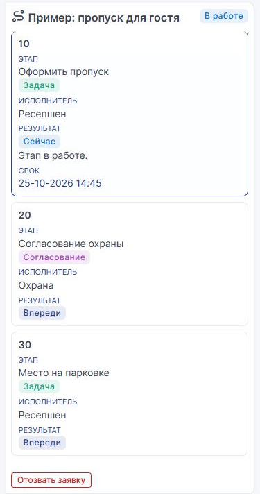

**Просрочка.** Ресепшен не успел за час. Раз в 15 минут «Сроки этапов»
отмечает просроченный этап: пометка «просрочен» в строке, комментарий
в заявке, запись в «Журнал маршрута».

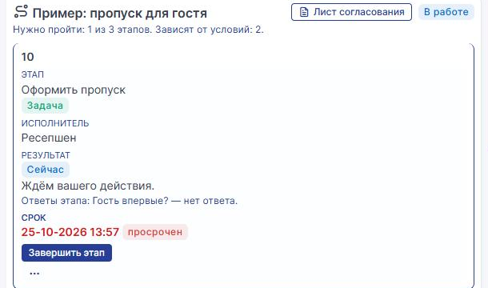

**Заявка по телефону.** Инициатор позвонил, и заявку завели вручную — не из
формы. Администратор маршрутов: вкладка «Маршрут этапов» → «Маршрут» →
«Запустить маршрут».

Ресепшен закрывает этап 10 («Гость впервые?» — «Нет») — этап 20 «Не нужен
по условию». Ответа формы «Гость на машине» нет, поэтому этап 30 спрашивает
исполнителя заявки: «Выполнять этап?» → причина → «Выполнить этап» или
«Этап не нужен».

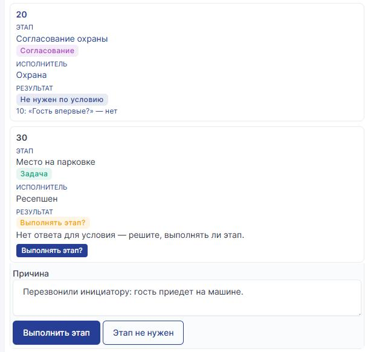

---

## 4. Ремонт оборудования

**Зачем.** Инженер диагностирует неисправность. Принтер всегда чинят на месте,
компьютер — если нужен выезд, иначе устройство принимают в мастерскую.
Запчасть заказывают дочерней заявкой. Если запчасти нет, маршрут
останавливается, и решает администратор маршрутов.

**Форма «Пример: неисправность оборудования».** «Что не работает» (категория
из ветки «Ремонт оборудования»: «Компьютер», «Принтер»), «Где стоит», «Что
случилось». Назначение «Заявка» — категория из ответа, группа «Служба
поддержки».

| № | Этап | Как выполняется | Кто | Особое |
|---|---|---|---|---|
| 10 | Диагностика | Задача | Сервисные инженеры | вопросы «Нужен выезд?», «Нужна запчасть?»; плановая продолжительность 1 час |
| 20 | Выезд к пользователю | Задача | Сервисные инженеры | если категория «Принтер» **или** 10 «Нужен выезд?» — да; можно пропустить |
| 25 | Принять в мастерскую | Задача | Сервисные инженеры | если этап 20 не нужен по условию |
| 30 | Заказать запчасть | Дочерняя заявка | Закупки | если 10 «Нужна запчасть?» — да; статус заявки «Ожидание»; при отказе — остановить маршрут |
| 40 | Ремонт | Задача | Сервисные инженеры | отчёт обязателен |

### Настройка

1. Маршрут: форма выбрана, «Запускать, если» — **«Не запускать по форме»**:
   маршрут запускает бизнес-правило. В «Дополнительно» — «Если действие
   не по порядку этапов» — «Предупредить».
2. **Администрирование → Правила → Бизнес-правила для заявок → Добавить**
   (в организации «Пример»): «Использовать правила для» — «Добавить»;
   критерий «Категория» — «под» — «Ремонт оборудования»; действие «Запустить
   маршрут этапов» — «Назначить» — этот маршрут. Строка готовности маршрута:
   «Готов к запуску · 5 этапов · запуск: правило «…»» и «Для заявок с форм
   «…» правило не сработает: там маршрут выбирает «Запускать, если».» — у тех
   форм свои маршруты, один путь запуска на форму.
3. Этап 10: два вопроса этапа, «Дополнительно» → «Плановая продолжительность
   задачи» — 1 час (для учёта трудозатрат, на срок не влияет).
4. Этап 20: «Нужны» — «хотя бы одно»: «Категория заявки» — «любая из» —
   «Принтер»; «10. Диагностика — «Нужен выезд?»» — «да». «Дополнительно» →
   «Этап можно пропустить» — «Да».

   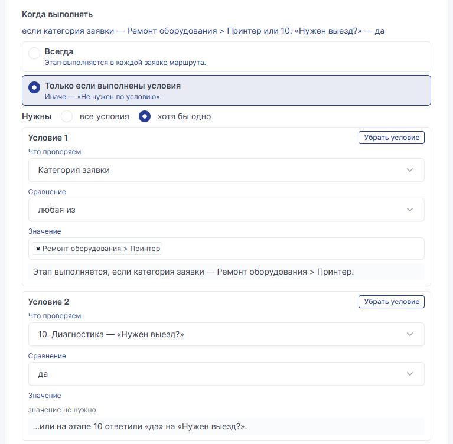

5. Этап 25: «Что проверяем» — «20. Выезд к пользователю — не нужен
   по условию» — «не нужен по условию».
6. Этап 30: «Дочерняя заявка» в «Закупки». «Статус заявки на этапе» —
   «Ожидание»: пока закупают, основная заявка ждёт. «Что делать при отказе» —
   «Остановить маршрут». «Куда вернуть после уточнения» — этапы 10 и 30: с них
   же можно начать заново.

   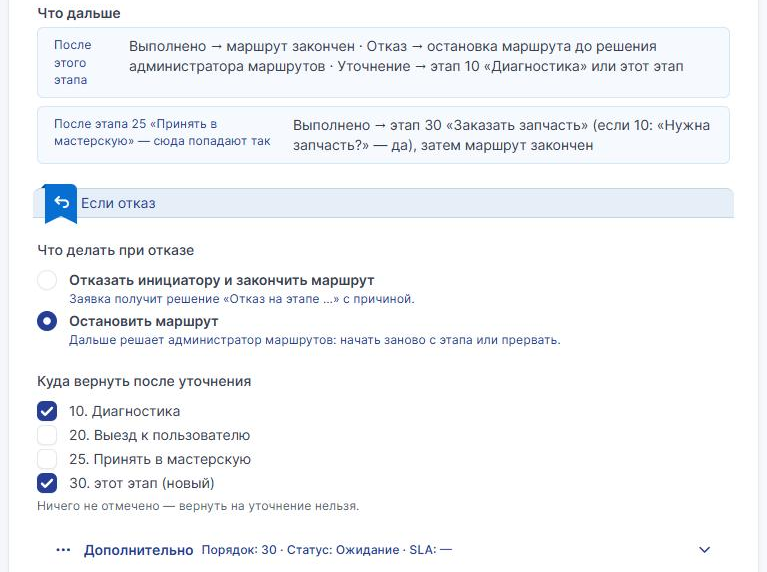

### Как это выглядит

**Попытка 1.** Инициатор выбирает «Принтер» — правило запускает маршрут.
Инженер закрывает 10: выезд — «Нет», запчасть — «Да». Этап 20 всё равно
выполняется: категория «Принтер». Инженер уезжает на другой объект: меню
«…» строки 20 → «Передать этап…» → пользователь или группа, причина. Этап
закрывает коллега. Этап 25 — «Не нужен по условию» («этап 20 выполнялся»).

Закупки в дочерней заявке → «Отметить результат» → «Отказ» с ответом
инициатору (запчасть сняли с производства). Маршрут «Остановлен»: «Решает
администратор маршрутов.».

**Решить заявку раньше времени.** Пока маршрут стоит, специалист решает заявку
штатно. «Решить заявку — только после всех этапов» вместе с «Предупредить»
пропускает решение, но показывает предупреждение «Нельзя добавить решение.
Маршрут «…» остановлен: возобновите или прервите его.» и пишет запись
в «Журнал маршрута» («разрешено, записано»). С «Запретить» решение
не сохранится. Пользователей с правом «Закрытие этапа без ответа» проверка
не касается.

Режим меняют и массово: список маршрутов → отметить → «Действия» →
«Обновление» → «Если действие не по порядку этапов». Начатые заявки идут по
своей версии маршрута: новый режим действует на новые заявки.

**Новая попытка.** Поставщик нашёл совместимую деталь. Решённую заявку
сначала откройте в GLPI (инициатор отклоняет решение). Администратор
маршрутов: строка 30 → меню «…» → «Начать заново с этапа…» → «С этапа» — 10,
«Что изменилось в заявке» → «Начать заново».

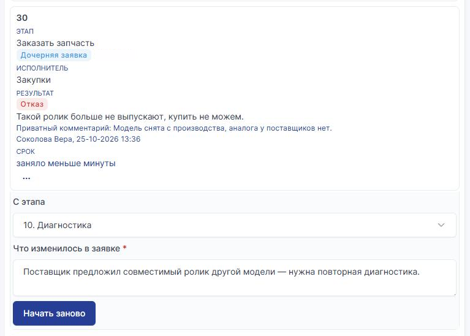

**Попытка 2.** Инженер: выезд — «Нет», запчасть — «Нет». Этап 20 снова нужен
(принтер), но пользователь сам принёс принтер — инженер нажимает
«Пропустить» с причиной. Этап 20 «Пропущен» — это не «не нужен по условию»,
ответ для условия этапа 25 неизвестен, и по «Если ответа нет» («выполнять
этап») этап 25 выполняется. Этап 30 не нужен, 40 закрывается с отчётом —
заявка решена.

«Схема» на заявке (у администратора маршрутов) показывает маршрут той версии,
что была при запуске: пропуски, обходы по условию, «Начато заново → этап 10».

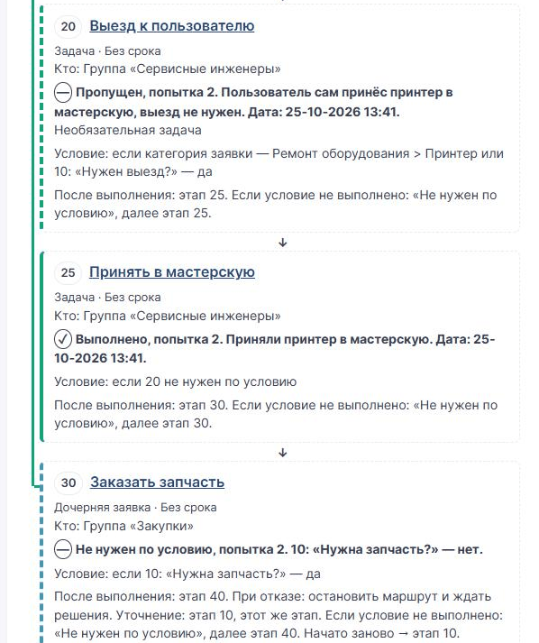

**Обзор.** Над списком маршрутов — «Узкие места маршрутов»: по выбранному
маршруту число заявок, среднее время и медиана, просрочки, отказы, передачи
по этапам.

---

## 5. Покупка программы

**Зачем.** Руководитель одобряет покупку, служба поддержки проверяет
совместимость. Если сумма больше 100 000 руб. или лицензий больше 10,
покупку согласует комиссия. Если счёта нет, закупки его запрашивают. Оплату
закупки подтверждают согласованием в дочерней заявке.

**Форма «Пример: покупка программы».** «Название программы», «Число
лицензий» (число), «Сумма, руб.» (число), «Счёт или предложение поставщика»
(файл), «Руководитель» (пользователь). Назначение «Заявка» с согласованием
руководителя, как в процессе 1.

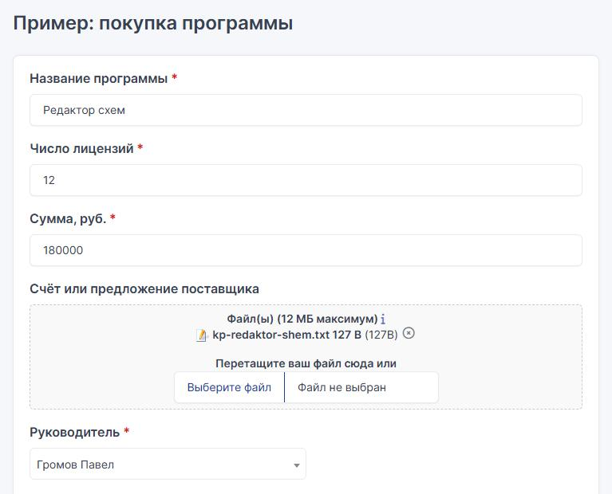

| № | Этап | Как выполняется | Кто | Особое |
|---|---|---|---|---|
| 10 | Согласование руководителя | Согласование | из формы | при отказе — отказ инициатору |
| 20 | Проверить совместимость | Задача | Служба поддержки | отчёт обязателен |
| 30 | Согласование комиссии | Согласование | группа «Комиссия», «Каждый в группе», нужно 50 % | если сумма больше 100 000 **или** лицензий больше 10 |
| 40 | Запросить счёт | Задача | Закупки | если файл не приложен |
| 50 | Оплатить | Дочерняя заявка | Закупки | «Согласованием в дочерней заявке» |

### Настройка

1. Этап 30: «Задан в этапе», «Или согласующие группы» — «Комиссия», «Как
   согласует группа» — «Каждый в группе» (запрос каждому участнику).
   «Дополнительно» → «Нужно одобрений, %» — 50: из трёх нужно двое, считается
   как в GLPI. «Нужны» — «хотя бы одно»: «Сумма, руб.» — «больше» — 100000;
   «Число лицензий» — «больше» — 10.

   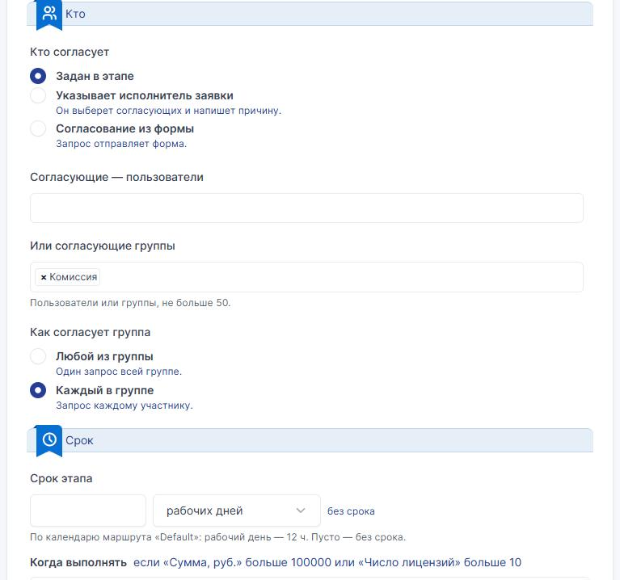

2. Этап 40: «Счёт или предложение поставщика» — «не заполнено». Фраза:
   «Этап выполняется, если в форме не приложен файл «…».».
3. Этап 50: «Дочерняя заявка», «Как отдел сообщает результат» —
   «Согласованием в дочерней заявке»: группе отдела уходит запрос
   на согласование, результат — по их ответам.

### Как это выглядит

**Дорогая покупка со счётом.** Руководитель одобряет, служба поддержки
закрывает 20. На этапе 30 у каждого члена комиссии свой запрос, в строке —
«Одобрили 1 из 3, нужно 2.». Второго одобрения хватает, третий ответ не нужен.

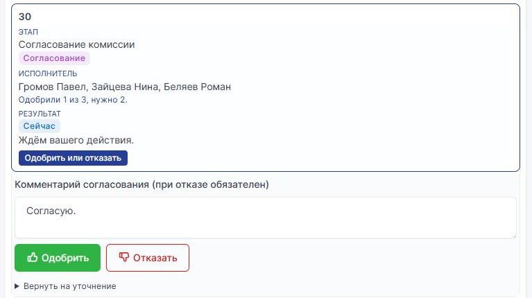

Счёт приложен — этап 40 «Не нужен по условию». Закупки одобряют запрос
в дочерней заявке «Оплатить — к заявке №…» (вкладка «Согласования» или лента
заявки), дочерняя заявка решается, основная — тоже: «Результат: Согласовано.».

**Дешёвая покупка без счёта.** Руководитель нажимает «Отказать» —
комментарий обязателен. Маршрут заканчивается, заявка решается с отказом:

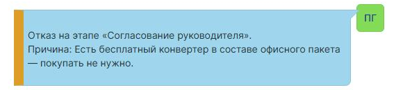

Если бы отказ ставил «Остановить маршрут», заявка ждала бы администратора
маршрутов, как в процессе 4.

---

## 6. Плановые работы

**Зачем.** Изменение GLPI (не заявка): совет по изменениям согласует план,
служба поддержки делает резервную копию и обновляет программу. Если после
обновления что-то не работает — откат.

**Формы нет:** изменения заводят специалисты. Запуск маршрута — вручную.

| № | Этап | Как выполняется | Кто | Особое |
|---|---|---|---|---|
| 10 | Согласование плана | Согласование | группа «Совет по изменениям», «Каждый в группе», нужно 100 % | — |
| 20 | Сделать резервную копию | Задача | Служба поддержки | отчёт обязателен |
| 30 | Обновить программу | Задача | Служба поддержки | вопрос «Всё работает после обновления?» |
| 40 | Откатить обновление | Задача | Служба поддержки | если 30 — «нет» |

### Настройка

1. Маршрут: «Дополнительно» → «Для чего маршрут» — «Изменения» (после первых
   запусков не меняйте). Блока «Запуск маршрута» нет: запуск по форме
   и дочерние заявки — только для заявок; у изменений и проблем этапы —
   «Задача» и «Согласование».
2. Этап 10: «Задан в этапе», группа, «Каждый в группе», «Нужно одобрений,
   %» — 100.
3. Этапы 20–40; у 40 условие «30: «Всё работает после обновления?» — нет».

### Как это выглядит

**Запуск.** Изменение создано → вкладка «Маршрут этапов» → «Запустить
маршрут».

**Право на согласование.** Сначала в этап поставили группу «Комиссия»
из процесса 5. Двое в ней работают в самообслуживании, а там нет права
согласовывать изменения. Маршрут проверяет каждого согласующего до отправки
запросов, и этап сказал, кому чего не хватает:

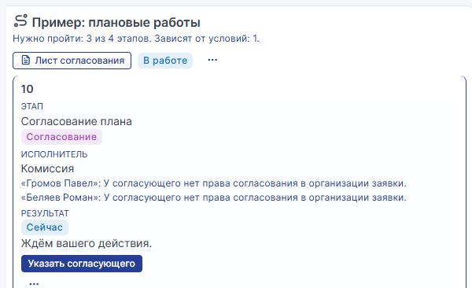

Право на согласование изменений задаётся в профиле GLPI. Решение — группа
«Совет по изменениям» из тех, у кого право есть. Запуск с неверным
составом администратор маршрутов прерывает: меню «…» в шапке → «Прервать
маршрут…» → причина (её увидит инициатор) → «Прервать маршрут». Открытые
этапы закрываются, неотвеченные запросы снимаются, изменение дальше ведут
обычным порядком.

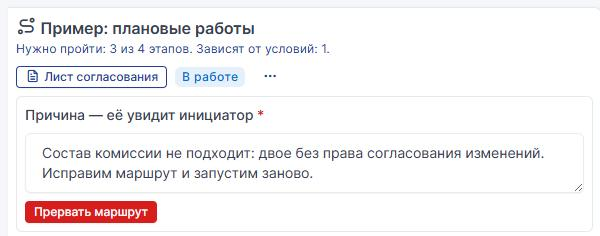

**Принудительное закрытие.** Маршрут исправили и запустили на новом изменении.
Двое из трёх одобрили, третий в отпуске, а нужно 100 %. Администратор
маршрутов: меню «…» строки 10 → «Закрыть принудительно…» → причина →
«Закрыть принудительно». Неотвеченный запрос снимается, результат этапа —
«Выполнено», маршрут идёт дальше.

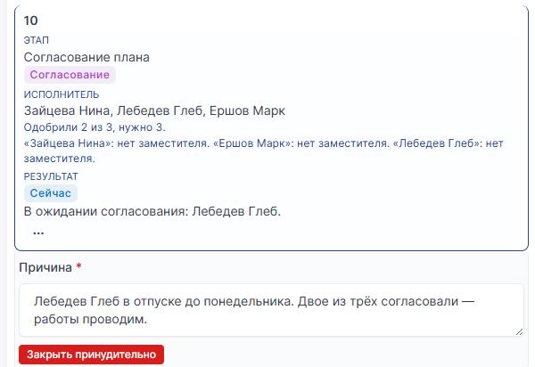

Задачу и согласование закрывает администратор маршрутов; любой текущий этап,
в том числе дочерней заявки, — дежурный с правом «Закрытие этапа без ответа».

Дальше: резервная копия, обновление — «Всё работает после обновления?» —
«Нет», этап 40 «Откатить обновление» — и изменение решено.

---

## Если маршрут встал

| Что видно | Что сделать |
|---|---|
| «Ждём ответы на вопросы этапа.» | ответы этапа не даны — «Вопросы этапа» → «Сохранить ответы» (процесс 2) |
| «Остановлен», «Решает администратор маршрутов.» | «Начать заново с этапа…» или «Прервать маршрут…» (процесс 4) |
| маршрут остановился после технического сбоя: группа не видна в организации заявки, срок не помещается | исправьте причину, затем «Возобновить маршрут» в меню «…» шапки |
| согласующий ответил, а этап стоит | «Сроки этапов» догонит за 15 минут; ответ того, кто уже не адресат, переносит администратор маршрутов: меню «…» строки этапа → «Перенести ответ согласующего» |
| статус заявки не сменился | проверьте `itilflow_status_sync` и cron; затем меню «…» строки этапа → «Повторить смену статуса» |

Подробнее — [FAQ.md](FAQ.md).

---

## Функция → процесс

| Функция | Где показана |
|---|---|
| Новый маршрут, строка готовности «Не готов… / Готов к запуску…» | 1 |
| «Организация», «Подчинённые организации», «Описание» | 1 |
| «Рабочий календарь» и сроки в рабочих днях | 1 |
| Маршрут без календаря, срок в рабочих часах | 3 |
| «Для чего маршрут»: заявки и изменения | 6 |
| «Маршрут включён»; импорт создаёт выключенным | 2 |
| Версия маршрута: начатые заявки идут по своей версии | 4 |
| Запуск по ответу формы: «Всегда» | 1, 3, 5 |
| Запуск по ответу формы: «Только если выполнены условия» | 2 |
| Несколько маршрутов одной формы, «Другие маршруты этой формы», пробел без маршрута | 2 |
| «Не запускать по форме» и бизнес-правило «Запустить маршрут этапов» | 4 |
| Один путь запуска на форму (правило не трогает формы с «Запускать, если») | 4 |
| Запуск вручную «Запустить маршрут» | 3, 6 |
| Этап «Задача», «Что сделать», «Отчёт при завершении» | 1, 3, 4, 6 |
| Этап «Дочерняя заявка»: «Где создать», «Как отдел сообщает результат» — «Исполнитель отмечает результат» | 1, 4 |
| «Как отдел сообщает результат» — «Согласованием в дочерней заявке» | 5 |
| «Результат отдела» → «Отметить результат»: «Выполнено», «Отказ» | 1, 4 |
| Этап «Согласование» — «Согласование из формы», «Этап согласования в форме» | 1, 5 |
| «Задан в этапе»: пользователи | 2 |
| «Задан в этапе»: группа, «Любой из группы» | 3 |
| «Задан в этапе»: группа, «Каждый в группе», «Нужно одобрений, %» | 5, 6 |
| «Указывает исполнитель заявки» → «Указать согласующего»; «Засчитать согласование» | 2 |
| «Что проверить согласующему» | 2 |
| Согласование в самообслуживании «Одобрить или отказать», «Согласовано» | 1, 5 |
| «Отказать» с причиной, решение «Отказ на этапе «…».» | 5 |
| «Когда выполнять»: «Всегда» / «Только если выполнены условия», до трёх условий | 1, 4, 5 |
| «Нужны»: «все условия» / «хотя бы одно» | 1, 4, 5 |
| Условие по вопросу этапа выше | 1, 2, 3, 6 |
| Условие по ответу формы: список, радио | 2, 3 |
| Условие по дате «раньше, чем через N дн. после подачи» | 1 |
| Условие по числу «больше» | 5 |
| Условие по файлу «не заполнено» | 5 |
| Условие «Категория заявки» | 4 |
| Условие «этап выше не нужен по условию» | 4 |
| «Если ответа нет»: «выполнять этап» | 4 |
| «Если ответа нет»: «спросить исполнителя заявки» → «Выполнять этап?» | 3 |
| «Не нужен по условию» с причиной в строке | 2, 3, 4, 5 |
| «Вопросы этапа» «да / нет»: у задачи в «Завершить этап» | 1, 3, 4, 6 |
| «Вопросы этапа» у согласования: «Сохранить ответы», «Сохранить и одобрить» | 2 |
| «Что дальше» в форме этапа | 1, 4 |
| «Порядок» этапа (этап между двумя) | 1 |
| Срок этапа, просрочка, автоматическое действие «Сроки этапов» | 3 |
| «Статус заявки на этапе», `itilflow_status_sync` | 3, 4 |
| «Плановая продолжительность задачи» | 4 |
| «Этап можно пропустить» → «Пропустить» | 4 |
| «Передать этап…» | 4 |
| «Вернуть на уточнение», «Куда вернуть после уточнения», «С этапа» | 2, 4 |
| «Ждём вашего ответа», ответ инициатора комментарием или письмом продолжает маршрут | 2 |
| «Что делать при отказе»: «Отказать инициатору…» / «Остановить маршрут» | 4, 5 |
| «Начать заново с этапа…» | 4 |
| Попытки и «История этапа» (после уточнения и новой попытки) | 2, 4 |
| «Прервать маршрут…» | 6 |
| «Закрыть принудительно…», право «Закрытие этапа без ответа» | 6 |
| Право GLPI на согласование: проверка согласующих | 6 |
| «Решить заявку — только после всех этапов», «Если действие не по порядку этапов», «Журнал маршрута» | 4 |
| Массовое изменение маршрутов | 4 |
| «Писать ход этапов в ленту заявки», решение «Заявка выполнена… Результат: …» | 1, 5 |
| «Вкладка маршрута у инициатора», карточки на телефоне | 3 |
| «Инициатор может отозвать заявку» → «Отозвать заявку» | 3 |
| Строка этапов: «Сейчас», «Впереди», «если …», счётчик «0/5», шапка «Нужно пройти…» | 1 |
| «Лист согласования» | 1 |
| «Схема» маршрута на заявке | 4 |
| «Узкие места маршрутов» | 4 |
| Подсказки строки готовности: заместитель, вариант без этапа, согласование по ответу инициатора | 2, 3 |
| Права плагина: вкладка профиля «Маршруты этапов» | [подготовка](#подготовка), 1 |
| Экспорт и импорт маршрутов, «Создать копией», «Устранять проблемы» | 2 |
| «Возобновить маршрут», «Перенести ответ согласующего», «Повторить смену статуса» | [«Если маршрут встал»](#если-маршрут-встал) |
