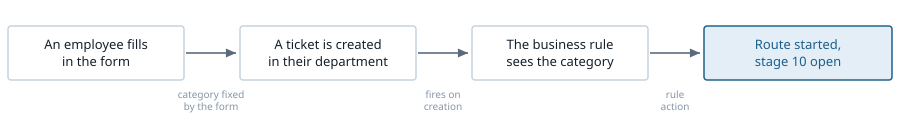

# Setting up a route step by step

English · **[Русский](TUTORIAL.md)**

Two illustrative examples. Entity, group and category names are made up —
use your own. The interface is Russian only; Russian labels are given in
«quotes» where it helps to find them on screen.

- **Example 1** — "Request with approval": manager approval → work by
  a department → answer to the requester: refusal, return for clarification,
  the result as the ticket solution.
- **Example 2** — "Work inside one department": three tasks in one ticket.
  The simplest setup. At the end — how to convert a route created before
  1.9.0.

Before you start: [installation](INSTALL.en.md) and the **Stage routes** right
in your own profile ([RIGHTS.en.md](RIGHTS.en.md)).

---

## Example 1. Request with approval

| # | Stage | Mode | Who | Refusal | Return for clarification |
|---|---|---|---|---|---|
| 10 | Manager approval | Approval | named during processing | abort | to stage 10 |
| 20 | Department work | Child ticket | group "Service department" | abort | to stage 10 or 20 |
| 30 | Answer to the requester | Task in the ticket | group "First line" | stop | — |

### Step 1. GLPI dropdowns

The route relies on stock GLPI dropdowns — prepare them first.

**Entities.** For the example: a root entity holding the requesters, and
a child entity "Service department" where the child ticket goes.

**Groups** (**Administration → Groups**):

| Group | Where | Flags |
|---|---|---|
| First line | root entity, **visible in child entities** | "Can be assigned to tickets" |
| Service department | entity "Service department" | "Can be assigned to tickets" |

Without "Can be assigned to tickets" the group is missing from the stage's
list. The group of a "Task in the ticket" stage must be visible in the
ticket's entity — hence "visible in child entities". Put people in the groups
(the "Users" tab).

**Categories** (**Setup → Dropdowns → Ticket categories**), both visible in
child entities:

1. "Request with approval" — the rule starts the route on it.
2. "Route stage" — a service category for stage child tickets.

**Profiles.** Each participant needs a technician profile in the entity where
their object lives: the approver and the first line in the ticket's entity,
the department's technician in "Service department". A self-service profile is
enough to answer approvals and to withdraw one's own ticket, but not to work
on stages.

**Calendar and SLA** — optional: a calendar for the stage deadline, an SLA for
the child ticket.

### Step 2. The route

**Administration → Stage routes → Add**

A new route uses the new outcome handling right away: refusal, return for
clarification, the result as the ticket solution. Nothing has to be switched
on separately.

| Field | Value | Why |
|---|---|---|
| Route name | Request with approval | seen by technicians and the requester |
| Entity | root | |
| Visible in child entities | **Yes** | otherwise a rule in a child entity cannot see the route |
| Working calendar | optional | stage deadlines in working days are counted on it |
| Route enabled | Yes | a disabled route does not start on new tickets |
| Description | optional | seen by administrators only |

Everything else is under the collapsed **"More"**; its summary line shows the
values without expanding it. The defaults are fine to start with: for
tickets; if someone acts outside their stage — "Log"; solve the ticket only
after all stages; stage progress is written to the timeline (needed for stage
30's report to become the result); the route tab for the requester and
withdrawal of the ticket are on.

Save. A route without stages saves; the readiness line at the top says
"Not ready to start — missing: 1" with the item "No stages."

### Step 3. Stages

The **"Stages"** tab → "Add stage". The stage form shows only the fields of
the selected mode — switch **"How it is done"** and the form rearranges
itself. The stage number is filled in as the next ten, and "this stage" is
already ticked as a return point.

**Stage 10 — Manager approval**

| Block | Field | Value |
|---|---|---|
| What to do | Stage name | Manager approval |
| | How it is done | Approval |
| | Instructions | what the approver should check |
| Who | Who approves | Chosen during the run |
| Deadline | Stage deadline | 1 working day |
| On refusal | What to do on refusal | Answer the requester with a refusal and end the route (default) |
| | Where it can be returned for clarification | 10 — this stage (ticked automatically) |

Leave group and person empty: with "Chosen during the run" the form does not
show them — the ticket's assignee names the approver.

**Stage 20 — Department work**

| Block | Field | Value |
|---|---|---|
| What to do | Stage name | Department work |
| | How it is done | Child ticket |
| | Department ticket category | Route stage |
| | Instructions | what to do and what to write as the result |
| Who | Department (group) | Service department |
| | Where to create the department ticket | In the chosen entity → "Service department" |
| | How the department reports the result | Assignee marks the result (default) |
| Deadline | Stage deadline | 3 working days |
| On refusal | What to do on refusal | Answer the requester with a refusal and end the route |
| | Where it can be returned for clarification | 10 and 20 |

**Stage 30 — Answer to the requester**

| Block | Field | Value |
|---|---|---|
| What to do | Stage name | Answer to the requester |
| | How it is done | Task in the ticket |
| | Report on completion | Mandatory |
| | Instructions | write the answer for the requester |
| Who | Assignee group | First line |

A task has no "On refusal" block: refusals do not happen on it, and the
plugin sets the value itself.

**"More"** on a stage holds the order, the ticket status at the stage (by
default by mode: approval — "Approval", child ticket — "Pending", task —
"Processing"), the planned duration and "can be skipped" for a task, the SLA
for a child ticket, and how many approvals are needed for an approval.

When the stages are ready, the readiness line above the stage table says
"Ready to start". If something is missing, it names the stage and what to
choose, with a link to the stage.

### Step 4. Start by a rule

**Administration → Rules → Business rules for tickets → Add**

- **Criterion:** Category — is — "Request with approval".
- **Actions:**
  - Start stage route («Запустить маршрут этапов») — assign — "Request with
    approval";
  - assign the assignee group "First line" with a stock action of the same or
    another rule. The ticket needs an assignee: they name the approver and
    continue the route after clarification.

If the list of routes in the rule action is empty, the route lives in another
entity and is not flagged "Visible in child entities". The route's readiness
line shows this too: "Rule … will not see the route". Mind the rule order and
"Stop processing": a rule higher up may take the ticket first.

A route can also be started by hand: the ticket's **"Stage route"** tab → pick
the route → "Start route" (requires the Stage routes right).

**Catalogue form (optional).** In **Administration → Forms** create a form and,
in its destination, set the category "Request with approval" as a specific
value — the requester cannot pick the wrong category. In GLPI 11 the catalogue
is at `/ServiceCatalog`, a form at `/Form/Render/<form id>`.

### Step 5. Check

Walk the route as each participant, not as an administrator: as an
administrator you see neither visibility limits nor missing rights.

**Normal path**

1. **The requester** creates a ticket in "Request with approval". On the
   "Stage route" tab stage 10 is "Now", waiting for the ticket's assignee to
   name the approver.
2. **First line** (the ticket's assignee): in the stage 10 row (or **Answer →
   Name the approver**) picks a person and writes the basis in "Why them".
3. **The approver**: "Approve or refuse" in the stage row → "Approve" (or the
   stock approval answer in the timeline). Stage 10 is "Done", stage 20 opens,
   and a child ticket "[Этап 20, попытка 1] …" appears in "Service department".
4. **The department's technician** opens the child ticket, its route tab →
   "Record result" → writes the result → "Done". The child ticket is solved
   with the same text, stage 30 opens.
5. **First line**: "Complete stage" in the stage 30 row (or **Answer → Complete
   stage**), fills in "What was done".
6. The ticket is solved with "all stages of the route are done" and the result.
   The requester accepts the solution the stock way.

**Refusal.** The approver refuses with a comment — the ticket is solved with
"Refused at stage «Manager approval»" and the reason.

**Return for clarification.**

1. The department's technician: "Record result" → writes what to clarify →
   "Return for clarification".
2. The requester sees a request to reply with a comment, and replies.
3. First line: "Continue after clarification" → briefly what was clarified →
   which stage to continue from (10 or 20).
4. A new attempt opens; the earlier result is in the "Stage history".

**Also check**

- The child ticket cannot be solved by hand without an outcome — GLPI shows
  a message.
- While the route is not done the ticket cannot be solved (in Log mode the
  attempt passes but lands in "Out-of-order actions").
- The requester can withdraw the ticket with a reason — it is solved with that
  reason.
- The ticket status changes to "Approval" and "Pending" within a minute if
  `itilflow_status_sync` is enabled.
- The **approval sheet** (button in the tab header) shows the whole run.

---

## Example 2. Work inside one department

All stages are tasks in one ticket. Suits an internal procedure of one unit.

| # | Stage | How it is done | Group | Notes |
|---|---|---|---|---|
| 10 | Triage | Task in the ticket | First line | optional report |
| 20 | Do the work | Task in the ticket | Service department | deadline 1 working day |
| 30 | Check the result | Task in the ticket | First line | can be skipped, mandatory report |

1. **Groups.** Both groups are visible in the tickets' entity ("visible in
   child entities" from a parent entity): the task lives in the ticket itself,
   and for the duration of the stage the plugin adds the group to its
   assignees.
2. **Route.** As in example 1, with your own category and rule.
3. **Stages.** "How it is done" — "Task in the ticket". Stage 20 has "Stage
   deadline" — 1 working day, and the route has a working calendar:
   `itilflow_deadlines` marks it overdue. Stage 30 has "Stage can be skipped:
   Yes" under "More".
4. **Walk-through.** Each stage's assignee clicks "Complete stage" in the stage
   row or in **Answer → Complete stage**. Stage 30 also offers "Skip" — the
   reason is mandatory and goes to the timeline.
5. **End.** After stage 30 the ticket is solved automatically, and that
   stage's report is the result for the requester.

### A route created before 1.9.0

A route on the previous outcome handling shows a **"The route uses the
previous order"** banner («Маршрут работает по прежнему порядку») on its page
and the **"Convert to the new order"** button («Перевести на новый порядок»).
Before converting, a dialog lists what will be filled in: "abort" → "answer
the requester with a refusal", "stop" → "stop", "return to stage N" → "stop"
plus return point N; child tickets get "assignee marks the result", tasks
need no choice. Only empty fields are filled. Tickets already started finish
on the previous handling, new ones follow the new one. The form offers no way
back.

---

## Moving routes to another GLPI

Since 1.10.0 routes move as a file — the same way as GLPI 11 forms ("Import
forms"). Both the source and the target GLPI need itilflow 1.10.0.

**Export.** **Administration → Stage routes**: "Экспорт всех" (export all)
above the list, or select routes and use the "Экспорт" massive action. You
get a JSON file: routes with stages and the GLPI objects they refer to —
entities, groups, categories (by complete name), calendar and time to resolve
(by name), users (by login). Tickets, route progress and passwords are not
in the file.

**Import.** "Импорт маршрутов" above the list (requires create and update on
routes) → file → preview («Предварительный просмотр импорта»):

- **"Ready to be imported"** («Готов к импорту») — everything is found;
- **"Can't be imported"** («Не может быть импортирован») — something is not
  found, found more than once, or a stage lacks an assignee. "Resolve
  issues" («Устранять проблемы») → pick a replacement from the GLPI list for
  each object, or "-----" (leave empty) → preview again;
- **"A route with this name already exists — it will be skipped"** — by
  default the route is not created; «Создать копией» creates it as
  "… (копия)";
- the bin icon removes the route from the list.

Objects are looked up the same way as in the GLPI form import: by complete
name (or name) in your active entities, exactly one must match. Otherwise an
object with the same ID is used if its name is the same; such matches are
flagged «Найдено по номеру, проверьте» (found by ID, please check).

"Import" creates the routes **disabled**, in one transaction: if anything
fails, nothing is written. Existing routes are never changed. Then check each
route — the readiness line and the Stages tab — and enable it.

Business rules that start a route are not in the file: move them with the
standard GLPI rule export and import (**Administration → Rules → Business
rules for tickets**) — GLPI finds the "Start stage route" action value by the
route name. Or create the rule again, as in step 4.

---

## Rollout

1. A month in **Log** mode: out-of-order actions are logged, authority is
   always checked.
2. Review the log: regular bypassing usually points at the procedure — an
   unneeded stage, the wrong owner, an unrealistic deadline.
3. **Warn** for a transition period.
4. **Block** once bypasses have almost stopped.

Set up a substantially changed process as a new route, and keep the old one
while tickets still run on it.

Problems and their causes: [FAQ.en.md](FAQ.en.md).
