# Первый маршрут по шагам

**[English](TUTORIAL.en.md)** · Русский

Один пример от настройки до решённой заявки. Названия вымышленные — подставьте
свои. Что значит каждое поле — [REFERENCE.md](REFERENCE.md).

**Маршрут «Пример: выдача оборудования»** запускается по ответу формы
«Пример: заказ оборудования»:

| № | Этап | Как выполняется | Кто | Особое |
|---|---|---|---|---|
| 10 | Согласование руководителя | Согласование | руководитель из ответа формы | — |
| 20 | Подготовить | Задача | группа «Исполнители» | вопрос этапа «Нужна закупка?» |
| 25 | Согласовать закупку | Согласование | группа «Согласующие» | только если на этапе 20 ответили «да» |
| 30 | Выдача | Дочерняя заявка | группа «Исполнители» | затем заявка решается сама |

## Шаг 0. Подготовка в GLPI

Всё, кроме плагина, создаётся штатно в GLPI: организация, группы
и пользователи — **Администрирование**, этап согласования — **Настройки →
Выпадающие списки**, форма — **Администрирование → Формы**.

- Плагин установлен, cron и `itilflow_status_sync` включены
  ([INSTALL.md](INSTALL.md)); у вас «Маршруты этапов»: «Чтение»
  и «Обновление».
- Организация «Пример»; в ней группы «Исполнители» и «Согласующие»
  с «Отображать в заявке» → «Назначено» — «Да».
- Пользователи: инициатор, его руководитель, исполнитель (профиль центрального
  интерфейса в «Пример», участник «Исполнителей»), согласующий (участник
  «Согласующих»).
- Этап согласования GLPI «Согласование руководителя».
- Форма «Пример: заказ оборудования»: «Что нужно» (список «Монитор»,
  «Гарнитура», «Доступ к сетевой папке»), «Срочно» («Да» / «Нет»),
  «Руководитель» (пользователь), «Комментарий»; первые три обязательные.
  На снимке в шаге 9 у формы есть ещё «Когда нужно» и «Что ещё сделать» —
  необязательные, маршрут на них не опирается: их можно не создавать.
  Назначение «Заявка» создаёт заявку в «Пример» для группы «Исполнители»;
  согласование — ответ «Руководитель», этап согласования «Согласование
  руководителя».

## Шаг 1. Маршрут

**Администрирование → Маршруты этапов → Добавить:** «Название маршрута» —
«Пример: выдача оборудования», «Организация» — «Пример», «Маршрут включён» —
«Да» (так и стоит). «Добавить» — строка готовности: «Не готов к запуску:
1 проблема» с пунктом «Нет ни одного этапа.».

В блоке «Запуск маршрута» выберите «Форма» — «Пример: заказ оборудования»
и сохраните — появятся назначения формы. «Назначение формы» — ««Заявка» —
создаётся всегда». «Запускать, если» пока оставьте «Не запускать по форме» —
включим в шаге 7.

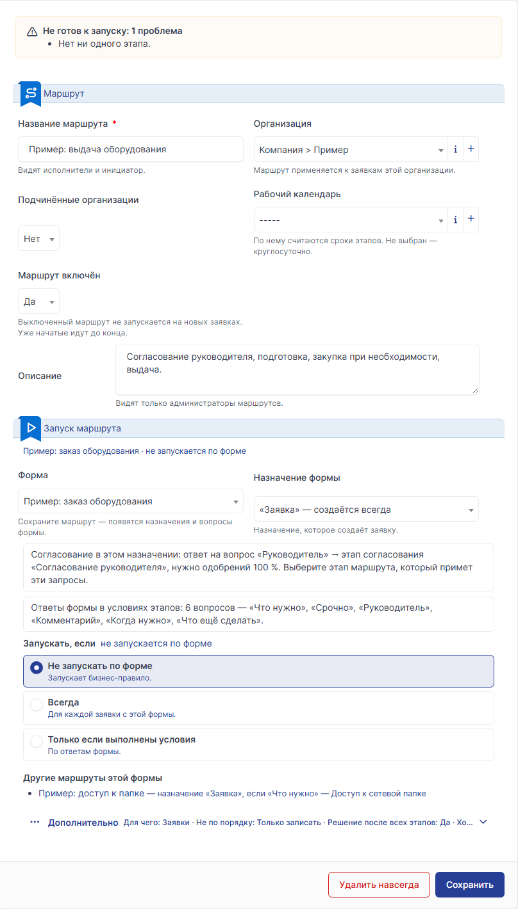

## Шаг 2. Этап 10

Вкладка «Этапы» → «Добавить этап». Форма показывает только поля выбранного
«Как выполняется».

| Поле | Значение |
|---|---|
| Название этапа | Согласование руководителя |
| Как выполняется | Согласование |
| Кто согласует | Согласование из формы |
| Этап согласования в форме | Согласование руководителя |

«Если отказ» оставьте по умолчанию: «Отказать инициатору и закончить маршрут».

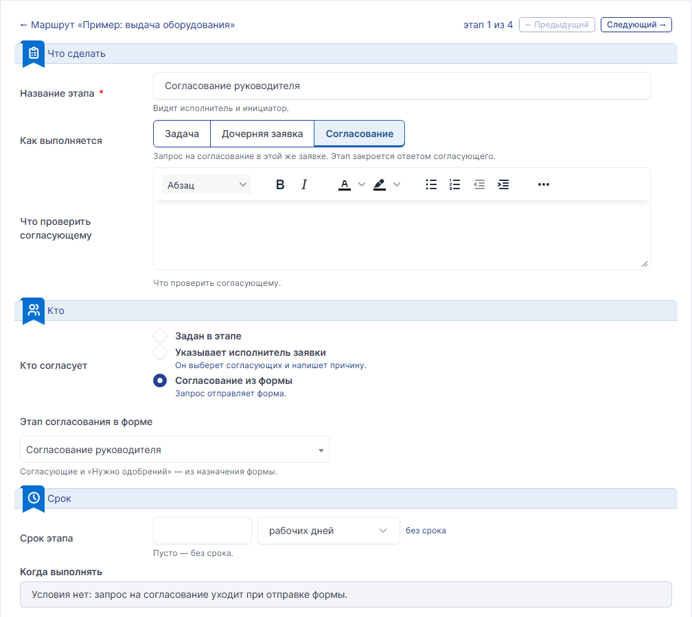

## Шаг 3. Этап 20

| Поле | Значение |
|---|---|
| Название этапа | Подготовить |
| Как выполняется | Задача |
| Отчёт при завершении | Обязательно |
| Группа | Исполнители |
| Срок этапа | 1 рабочий день |

«Вопросы этапа» → «+ Добавить вопрос» → «Нужна закупка?».

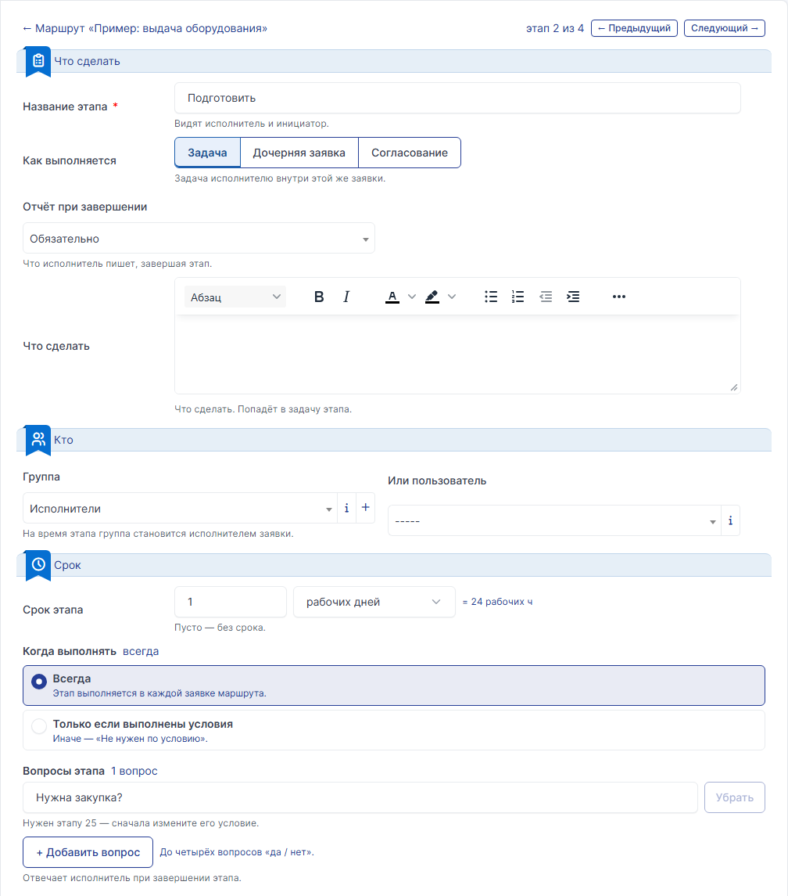

## Шаг 4. Этап 25

| Поле | Значение |
|---|---|
| Название этапа | Согласовать закупку |
| Как выполняется | Согласование |
| Кто согласует | Задан в этапе |
| Или согласующие группы | Согласующие, «Любой из группы» |
| Дополнительно → Порядок | 25 |

«Когда выполнять» — «Только если выполнены условия»; «Что проверяем» —
«20. Подготовить — «Нужна закупка?»», «Сравнение» — «да». Под условием:
«Этап выполняется, если на этапе 20 ответили «да» на «Нужна закупка?».»
«Если ответа нет» — «выполнять этап». «Что дальше» → «После этапа 20
«Подготовить» — сюда попадают так»: «Выполнено → этап 25 «Согласовать
закупку» (если 20: «Нужна закупка?» — да), затем маршрут закончен». Этапа 30
ещё нет — он появится здесь после шага 5.

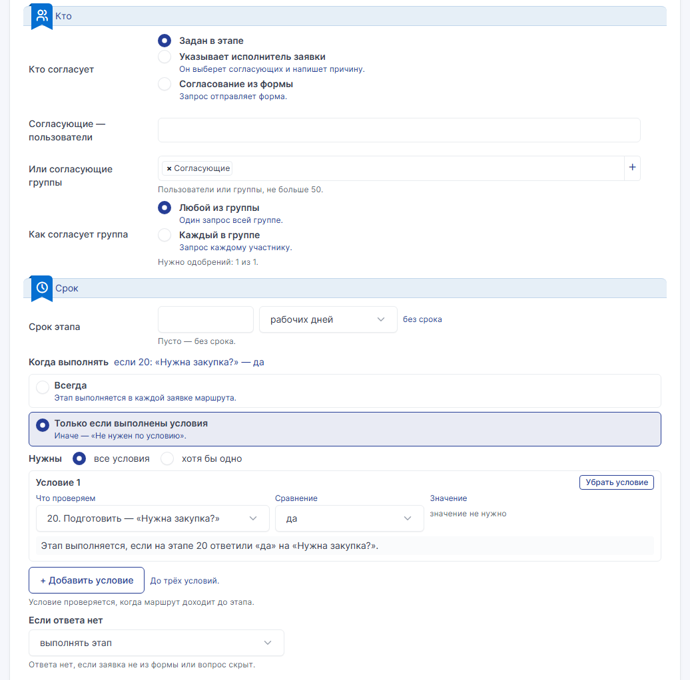

## Шаг 5. Этап 30

| Поле | Значение |
|---|---|
| Название этапа | Выдача |
| Как выполняется | Дочерняя заявка |
| Задание отделу | Выдать подготовленное |
| Группа отдела | Исполнители |
| Где создать дочернюю заявку | В организации основной заявки |
| Как отдел сообщает результат | Исполнитель отмечает результат |

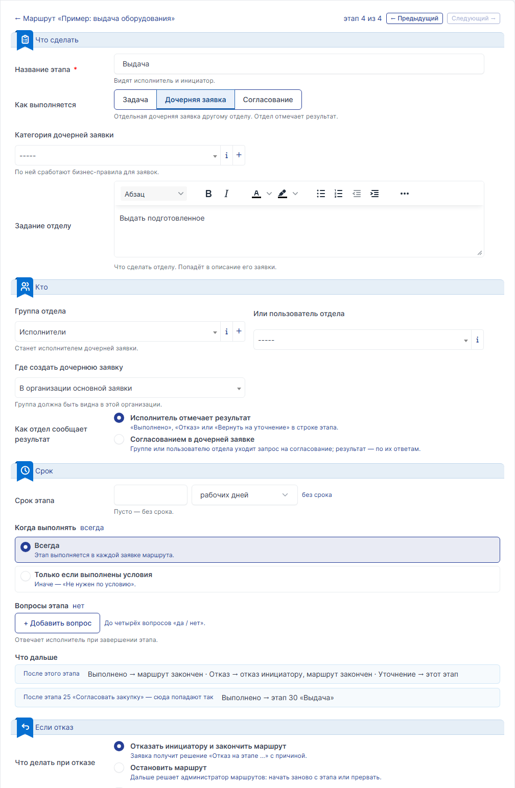

## Шаг 6. Проверка настройки

«Этапы»: «Готов к запуску · запуск вручную» (запуск по форме включим в шаге 7),
в «Когда» у этапа 25 — условие, стрелки ↑ ↓ меняют порядок. «Схема»: обход
этапа 25 справа. В этапе 25 «Что дальше» после этапа 20 теперь кончается
«затем этап 30 «Выдача»»: при «нет» маршрут сразу идёт к этапу 30.

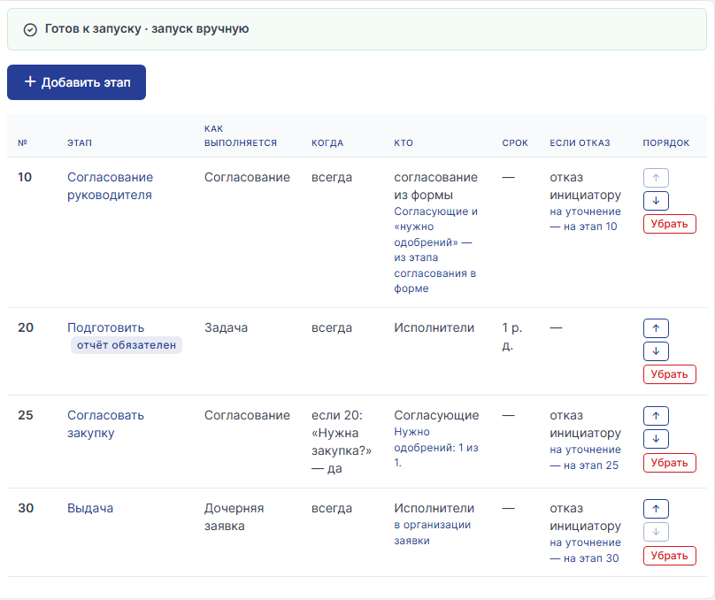

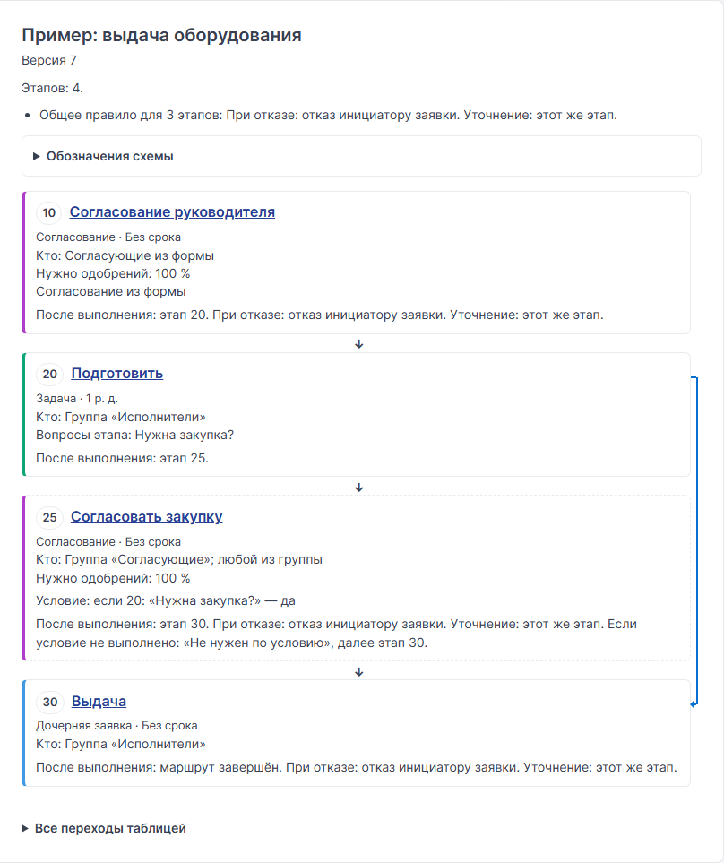

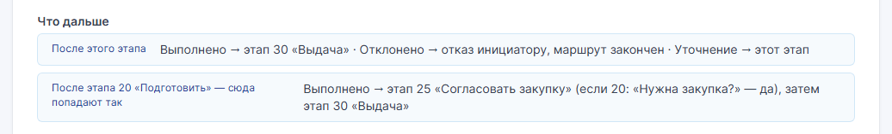

## Шаг 7. Запуск по ответу формы

«Запуск маршрута» → «Запускать, если» — «Только если выполнены условия»;
«Что нужно» — «любой из» — «Монитор», «Гарнитура». Сохраните. Строка
готовности: «Готов к запуску · 4 этапа · запускается по ответу формы «Пример:
заказ оборудования»». Бизнес-правило не нужно.

Ниже, пока второго маршрута нет, — примечание: «Назначение «Заявка»: если
«Что нужно» — «Доступ к сетевой папке», не запускается ни один маршрут —
заявка останется без маршрута.» Это не ошибка: такие заявки возьмёт второй
маршрут, после него примечание пропадёт.

Второй маршрут «Пример: доступ к папке» — та же форма и назначение, этап 10
такой же, этап 20 — задача «Открыть доступ»; «Запускать, если» — «Доступ
к сетевой папке». Оба маршрута покажут друг друга в «Другие маршруты этой
формы». Если условия пересекутся, маршрут будет не готов.

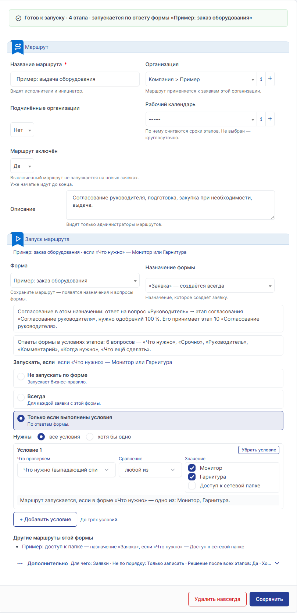

## Шаг 8. Права

**Администрирование → Профили → ‹профиль› → «Маршруты этапов».**
Администратору маршрутов — «Чтение» и «Обновление». Исполнителю права плагина
не нужны, нужен профиль центрального интерфейса в «Пример». Руководителю
и согласующим — право GLPI «Утверждения заявок»; хватит самообслуживания
([RIGHTS.md](RIGHTS.md)).

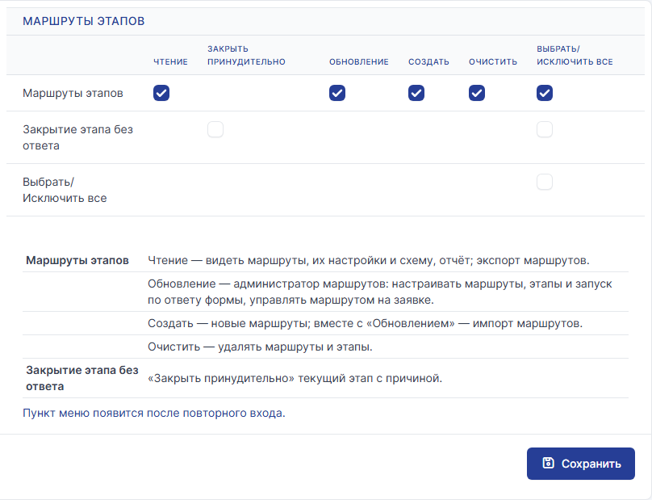

## Шаг 9. Инициатор

Проверяйте под каждым участником, а не под администратором.

Инициатор отправляет форму: «Что нужно» — «Монитор», «Срочно» — «Нет»,
«Руководитель» — свой руководитель. На вкладке «Маршрут этапов» (рядом
счётчик пройденных этапов «0/4»): этап 10 — «Сейчас», остальные — «Впереди».
Условий и вопросов этапа инициатор не видит. На телефоне — карточки.

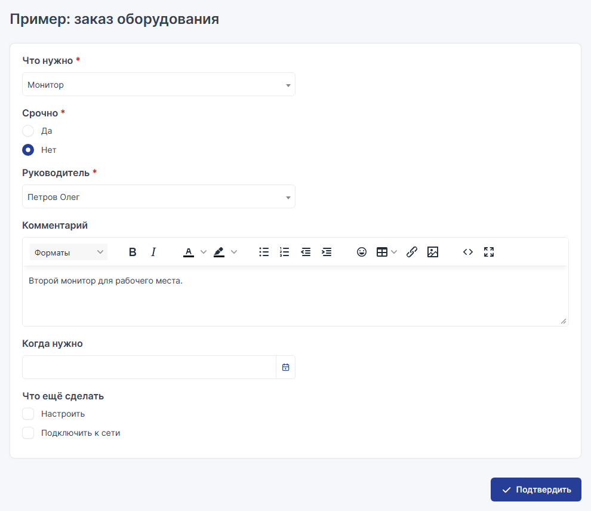

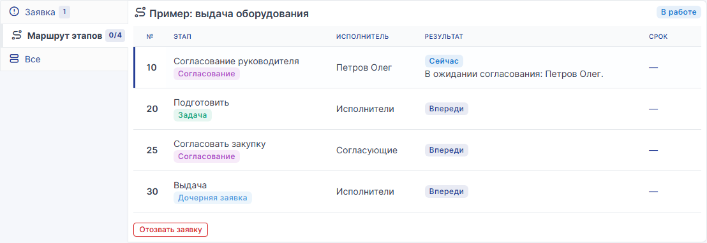

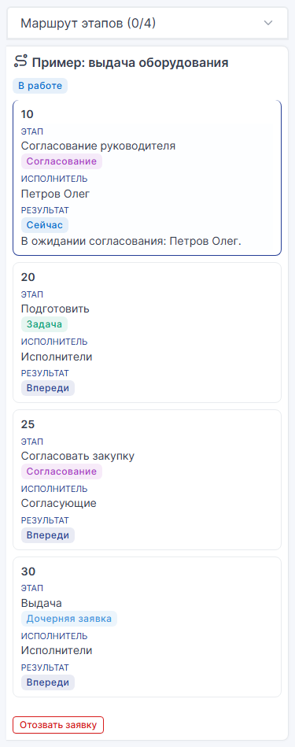

## Шаг 10. Руководитель

Строка этапа 10 → «Одобрить или отказать» → «Одобрить» (или ответ на запрос
в ленте заявки). Этап 10 — «Согласовано», начинается этап 20.

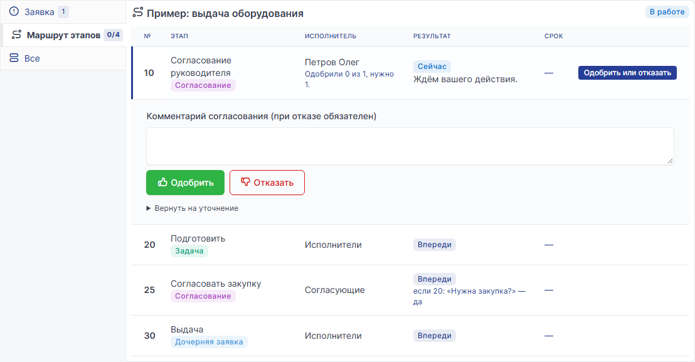

## Шаг 11. Исполнитель

Строка этапа 20 → «Завершить этап»: ответ на «Нужна закупка?», «Что сделано»,
«Завершить этап». Если после этого исполнитель больше не видит заявку,
откроется его главная страница. Здесь при «Нет» этап 30 ведёт та же группа
«Исполнители», и исполнитель остаётся на заявке.

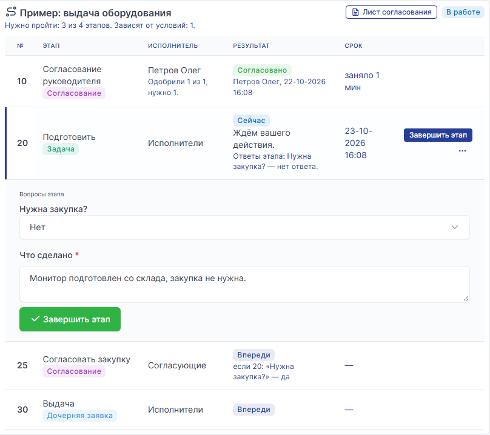

## Шаг 12. Две ветки

- «Да» — этап 25: запрос группе «Согласующие», любой участник одобряет.
- «Нет» — этап 25 «Не нужен по условию» с причиной «20: «Нужна закупка?» —
  нет», сразу начинается этап 30.

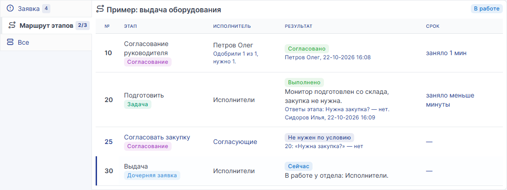

## Шаг 13. Дочерняя заявка

В «Пример» появилась дочерняя заявка «Выдача — к заявке №…»; в строке этапа 30
основной заявки — ссылка на неё «№…». Исполнитель:
вкладка «Результат отдела» → «Отметить результат» → «Ответ инициатору» →
«Выполнено». Дочерняя заявка решается сама.

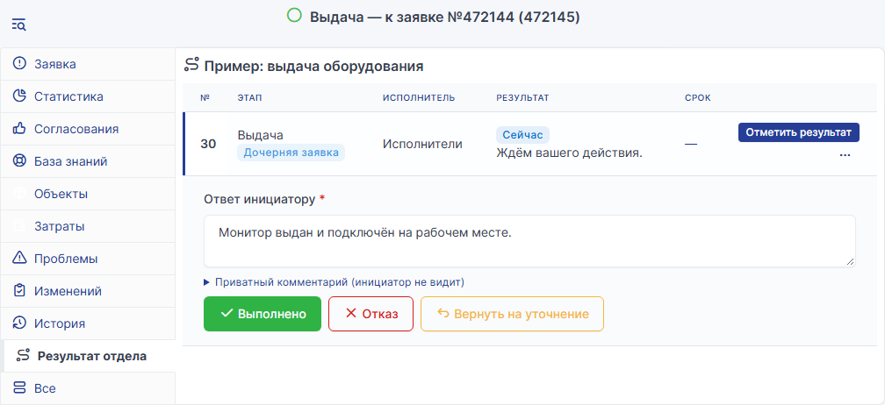

## Шаг 14. Итог

Основная заявка решается сама: «Заявка выполнена: все этапы маршрута «Пример:
выдача оборудования» пройдены. Результат: …». Инициатор принимает решение.

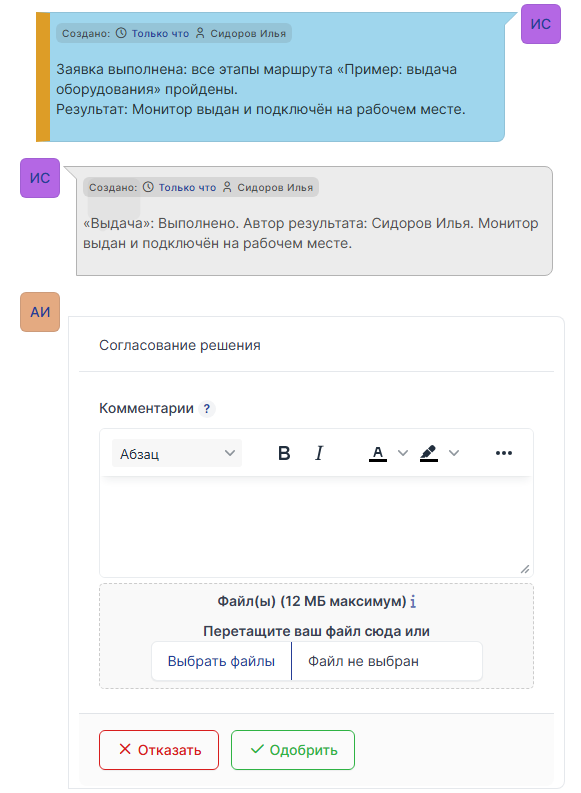

## Шаг 15. Вкладка у администратора маршрутов

На решённой заявке в шапке — «Все этапы пройдены, заявка решена.», «Нужно
пройти: 3 из 4 этапов (1 не нужен по условию).», «Лист согласования»,
«Пройден»; под таблицей — «Схема». «Журнал маршрута» появляется под ней,
когда в нём есть записи: действия не по порядку этапов, остановки, просрочки.

Пока маршрут идёт, есть ещё меню «…»: в шапке — «Прервать маршрут…», в строке
текущего этапа — «Передать этап…», «Закрыть принудительно…» (что разрешено —
[RIGHTS.md](RIGHTS.md)). На решённой заявке этих меню нет.

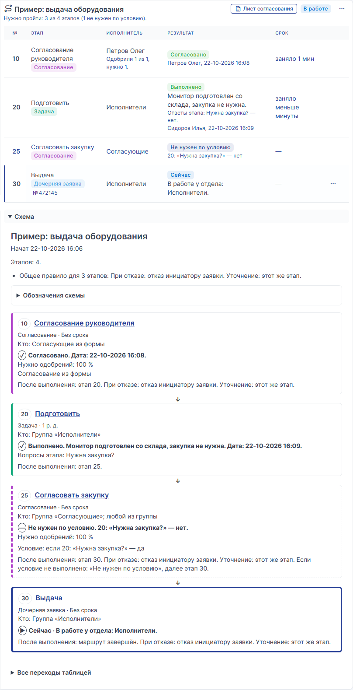

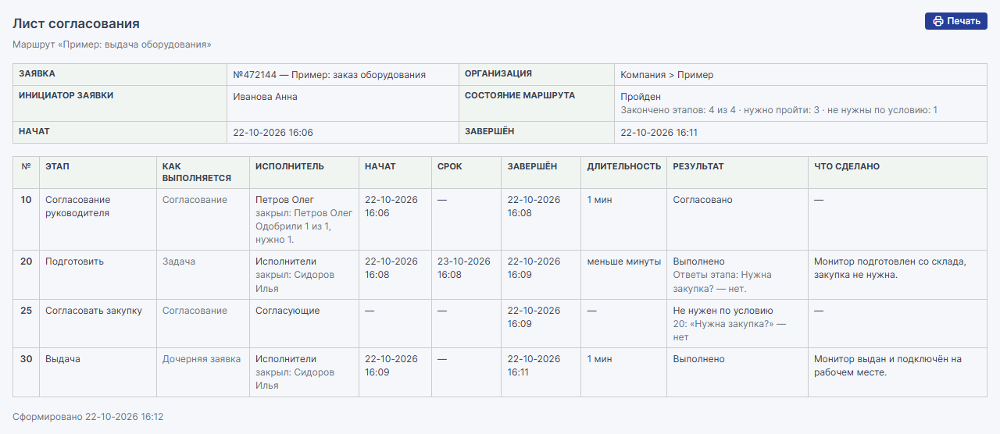

## Дальше

- Отказ, уточнение, «Начать заново с этапа…» —
  [REFERENCE.md](REFERENCE.md#6-результат-отказ-уточнение).
- Запуск правилом и вручную — [REFERENCE.md](REFERENCE.md#5-запуск-маршрута).
- Перенос в другую GLPI — [TRANSFER.md](TRANSFER.md); ошибки — [FAQ.md](FAQ.md).
