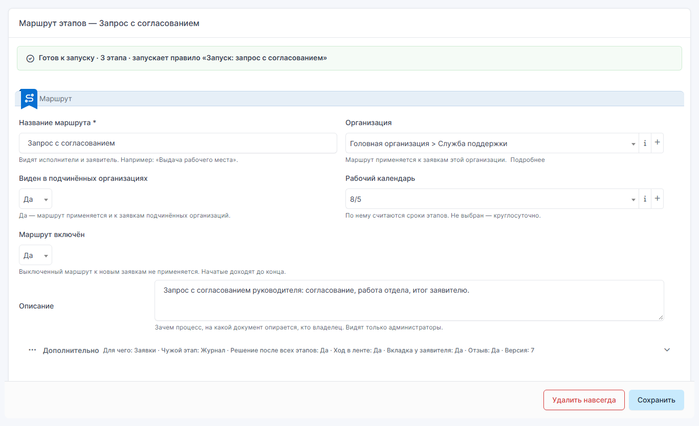
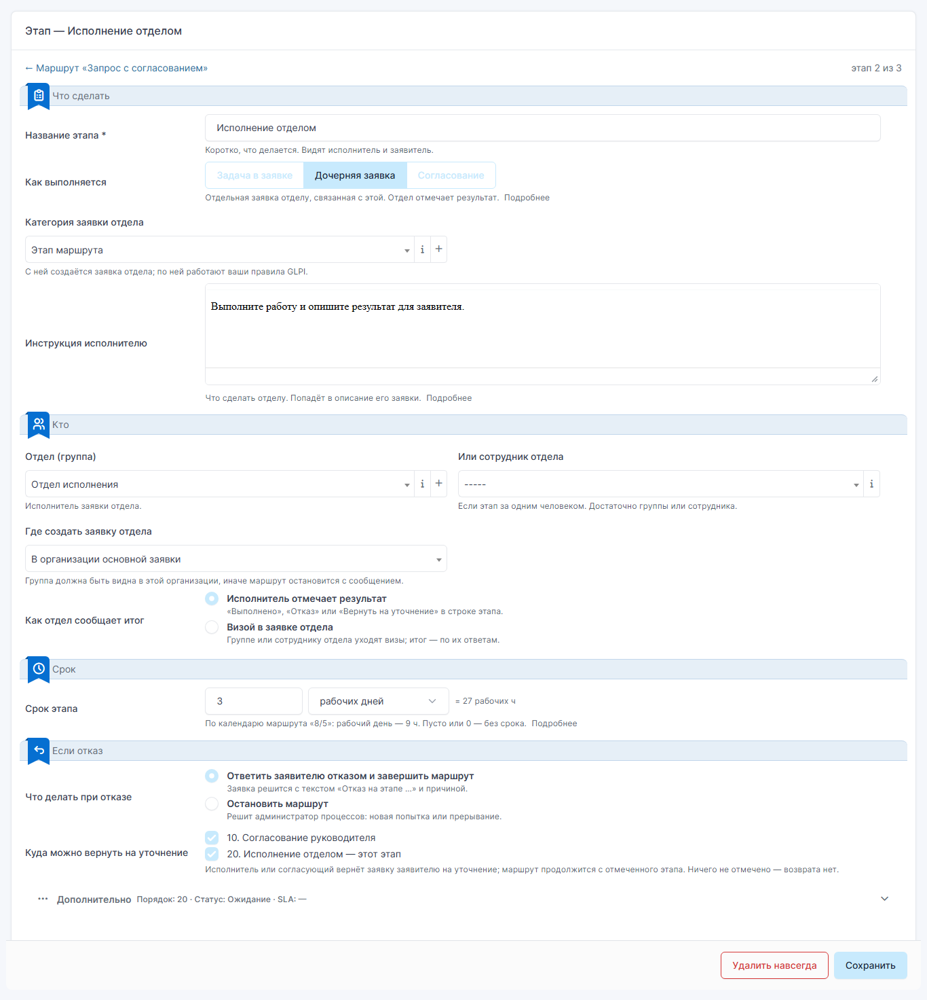
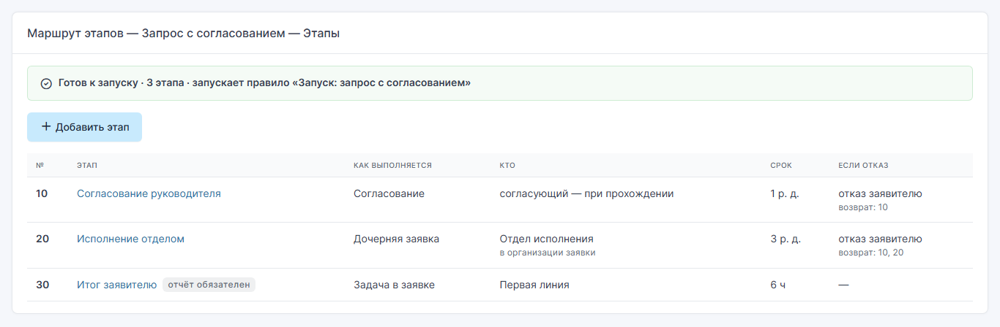
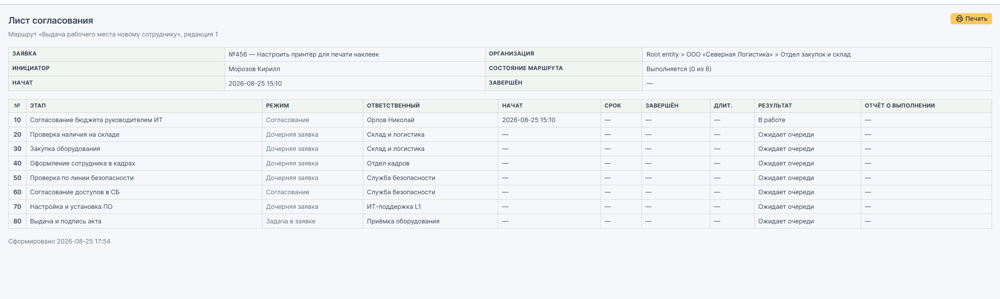

# Настройка маршрута по шагам

**[English](TUTORIAL.en.md)** · Русский

Два условных примера. Названия организаций, групп и категорий вымышленные —
подставьте свои.

- **Пример 1** — «Запрос с согласованием»: согласование руководителя →
  исполнение отделом → итог заявителю: отказ, возврат на уточнение, итог
  решением заявки.
- **Пример 2** — «Работа внутри отдела»: три задачи в одной заявке. Самая
  простая настройка. В конце — как перевести маршрут, заведённый до 1.9.0.

Перед началом — [установка](INSTALL.md) и право **«Маршруты этапов»** в своём
профиле ([RIGHTS.md](RIGHTS.md)). Как слова плагина называются на экранах
GLPI (например, заявитель — «Инициатор запроса») — в [CONCEPTS.md](CONCEPTS.md#слова-плагина-glpi-и-itsm).

---

## Пример 1. Запрос с согласованием

| № | Этап | Режим | Кто делает | Отказ | Возврат на уточнение |
|---|---|---|---|---|---|
| 10 | Согласование руководителя | Согласование | указывается при прохождении | прервать | к этапу 10 |
| 20 | Исполнение отделом | Дочерняя заявка | группа «Отдел исполнения» | прервать | к этапу 10 или 20 |
| 30 | Итог заявителю | Задача в заявке | группа «Первая линия» | остановить | — |

### Шаг 1. Справочники GLPI

Маршрут опирается на штатные справочники — подготовьте их первыми.

**Организации.** Для примера: корневая организация, в ней заявители,
и подчинённая организация «Отдел исполнения» — туда уйдёт дочерняя заявка.

**Группы** (**Администрирование → Группы**):

| Группа | Где | Признаки |
|---|---|---|
| Первая линия | корневая организация, **«Подчинённые организации» — Да** | «Отображать в заявке» → «Назначено» — Да |
| Отдел исполнения | организация «Отдел исполнения» | «Отображать в заявке» → «Назначено» — Да |

Без «Назначено — Да» в блоке «Отображать в заявке» группы нет в списке этапа.
Группа этапа «Задача в заявке» должна быть видна в организации заявки — отсюда
«Подчинённые организации — Да». Включите людей в группы (вкладка «Пользователи»).

**Категории** (**Настройки → Выпадающие списки → Категории ITIL**), обе видимые
в подчинённых организациях:

1. «Запрос с согласованием» — по ней правило запустит маршрут.
2. «Этап маршрута» — служебная, для дочерних заявок этапов.

**Профили.** Каждому участнику нужен профиль обычного интерфейса GLPI
(например, Technician) в той организации, где лежит его объект: согласующему
и первой линии — в организации заявки, исполнителю отдела — в «Отделе
исполнения». Профиль упрощённого интерфейса (Self-Service) позволяет отвечать
на запросы на согласование и отзывать свою заявку, но не работать с этапами.

**Календарь и SLA** — по желанию: календарь для срока этапа, SLA для
дочерней заявки.

### Шаг 2. Маршрут

**Администрирование → Маршруты этапов → Добавить**

Новый маршрут сразу работает по новому порядку исходов: отказ, возврат
на уточнение, итог решением заявки. Отдельно включать ничего не нужно.

| Поле | Значение | Зачем |
|---|---|---|
| Название маршрута | Запрос с согласованием | видят исполнители и заявитель |
| Организация | корневая | |
| Виден в подчинённых организациях | **Да** | иначе правило в подчинённой организации не увидит маршрут |
| Рабочий календарь | по желанию | по нему считаются сроки этапов в рабочих днях |
| Маршрут включён | Да | выключенный маршрут к новым заявкам не применяется |
| Описание | по желанию | видят только администраторы |

Остальное — в свёрнутом **«Дополнительно»**, строка-сводка показывает значения
и без раскрытия. Умолчания подходят для начала: для заявок; если действуют
не в свой этап — «Журнал»; решить заявку — только после всех этапов; ход
этапов пишется в ленту (нужно, чтобы отчёт этапа 30 попал в итог); вкладка
маршрута у заявителя и отзыв заявки включены.

Сохраните. Маршрут без этапов сохраняется; сверху появится строка готовности
«Не готов к запуску — не хватает: 1» с пунктом «Нет ни одного этапа.».

### Шаг 3. Этапы

Вкладка **«Этапы»** → «Добавить этап». Форма этапа показывает только поля
выбранного режима — переключайте **«Как выполняется»**, и форма перестроится.
Номер этапа подставляется следующим десятком, точкой возврата сразу отмечен
«этот этап».

**Этап 10 — Согласование руководителя**

| Блок | Поле | Значение |
|---|---|---|
| Что сделать | Название этапа | Согласование руководителя |
| | Как выполняется | Согласование |
| | Инструкция исполнителю | что согласующему проверить |
| Кто | Кто согласует | Выбирают при прохождении |
| Срок | Срок этапа | 1 рабочий день |
| Если отказ | Что делать при отказе | Ответить заявителю отказом и завершить маршрут (по умолчанию) |
| | Куда можно вернуть на уточнение | 10 — этот этап (отмечен сам) |

Группу и сотрудника не заполнять: при «Выбирают при прохождении» их в форме
нет — согласующего укажет исполнитель заявки.

**Этап 20 — Исполнение отделом**

| Блок | Поле | Значение |
|---|---|---|
| Что сделать | Название этапа | Исполнение отделом |
| | Как выполняется | Дочерняя заявка |
| | Категория заявки отдела | Этап маршрута |
| | Инструкция исполнителю | что сделать и что написать в результате |
| Кто | Отдел (группа) | Отдел исполнения |
| | Где создать заявку отдела | В указанной организации → «Отдел исполнения» |
| | Как отдел сообщает итог | Исполнитель отмечает результат (по умолчанию) |
| Срок | Срок этапа | 3 рабочих дня |
| Если отказ | Что делать при отказе | Ответить заявителю отказом и завершить маршрут |
| | Куда можно вернуть на уточнение | 10 и 20 |

**Этап 30 — Итог заявителю**

| Блок | Поле | Значение |
|---|---|---|
| Что сделать | Название этапа | Итог заявителю |
| | Как выполняется | Задача в заявке |
| | Отчёт при завершении | Обязательно |
| | Инструкция исполнителю | сформулировать ответ заявителю |
| Кто | Группа-исполнитель | Первая линия |

У задачи блока «Если отказ» нет: отказа на ней не бывает, значение плагин
ставит сам.

**«Дополнительно»** у этапа — порядок, статус заявки на этапе (по умолчанию
по режиму: согласование — «Согласование», дочерняя — «Ожидание», задача —
«В работе (назначена)»), плановая продолжительность и «можно пропустить»
у задачи, SLA у дочерней, сколько одобрений нужно у согласования.

Когда этапы готовы, строка готовности над таблицей этапов скажет «Готов
к запуску». Если чего-то не хватает — назовёт этап и что выбрать, со ссылкой
на этап.

### Шаг 4. Запуск правилом

**Администрирование → Правила → Бизнес-правила для заявок → Добавить**

- **Критерий:** Категория — равен — «Запрос с согласованием».
- **Действия:**
  - Запустить маршрут этапов — Назначить — «Запрос с согласованием»;
  - Группа специалистов — Назначить — «Первая линия» (штатное действие
    того же или другого правила). У заявки должен быть исполнитель: он укажет
    согласующего и продолжит маршрут после уточнения.

Если список маршрутов в действии правила пуст — маршрут лежит в другой
организации и не помечен «Виден в подчинённых организациях». Строка
готовности маршрута тоже это покажет: «Правило … не увидит маршрут». Учитывайте порядок
правил и действие «Пропуск оставшихся правил»: правило выше может перехватить заявку.

Маршрут можно запустить и вручную: вкладка **«Маршрут этапов»** заявки →
выбрать маршрут → «Запустить маршрут» (нужно право «Маршруты этапов»).

**Форма каталога (по желанию).** В **Администрирование → Формы** создайте
форму и в её назначении задайте категорию «Запрос с согласованием» конкретным
значением — заявитель не ошибётся с категорией. В GLPI 11 каталог открывается
по адресу `/ServiceCatalog`, форма — `/Form/Render/<номер формы>`.

### Шаг 5. Проверка

Проходите маршрут под каждым участником, а не под администратором:
под администратором не видно ни ограничений видимости, ни нехватки прав.

**Обычный путь**

1. **Заявитель** создаёт заявку категории «Запрос с согласованием».
   На вкладке «Маршрут этапов»: этап 10 — «Сейчас», «Ждём: исполнитель заявки
   укажет согласующего».
2. **Первая линия** (исполнитель заявки): в строке этапа 10 (или **Ответ →
   Указать согласующего**) выбирает сотрудника и пишет основание в «Почему он».
3. **Согласующий**: в строке этапа «Согласовать или отказать» → «Одобрить»
   (или тот же штатный ответ «Одобрить» на запрос на согласование в ленте). Этап 10 — «Выполнено», открыт этап 20,
   в «Отделе исполнения» появилась дочерняя заявка «[Этап 20, попытка 1] …».
4. **Исполнитель отдела** открывает дочернюю заявку, вкладку маршрута →
   «Отметить результат» → пишет результат → «Выполнено». Дочерняя заявка
   решается тем же текстом, открыт этап 30.
5. **Первая линия**: «Завершить этап» в строке этапа 30 (или **Ответ →
   Завершить этап**), заполняет «Что сделано».
6. Заявка решена: «Заявка выполнена: все этапы маршрута „Запрос
   с согласованием“ пройдены. Итог: …». Заявитель одобряет решение
   штатно.

**Отказ.** Согласующий отказывает с комментарием — заявка решается
с текстом «Отказ на этапе „Согласование руководителя“» и причиной.

**Возврат на уточнение.**

1. Исполнитель отдела: «Отметить результат» → пишет, что уточнить →
   «Вернуть на уточнение».
2. Заявитель видит просьбу ответить комментарием и отвечает.
3. Первая линия: «Продолжить после уточнения» → кратко, что уточнено →
   с какого этапа продолжить (10 или 20).
4. Открывается новая попытка; прежний результат — в «Истории этапа».

**Что ещё проверить**

- Решить дочернюю заявку вручную, без исхода, нельзя — GLPI покажет сообщение.
- Пока маршрут не пройден, заявку нельзя решить (в режиме «Журнал» попытка
  пройдёт, но попадёт в «Действия вне порядка этапов»).
- Заявитель может отозвать заявку с причиной — она решается с этой причиной.
- Статус заявки меняется на «Согласование» и «Ожидание» в течение минуты,
  если включено `itilflow_status_sync`.
- **Лист согласования** (кнопка в шапке вкладки) показывает весь ход.

---

## Пример 2. Работа внутри отдела

Все этапы — задачи в одной заявке. Подходит для внутренней процедуры одного
подразделения.

| № | Этап | Как выполняется | Группа | Особенности |
|---|---|---|---|---|
| 10 | Разбор заявки | Задача в заявке | Первая линия | отчёт по желанию |
| 20 | Выполнение работ | Задача в заявке | Отдел исполнения | срок 1 рабочий день |
| 30 | Проверка результата | Задача в заявке | Первая линия | можно пропустить, отчёт обязателен |

1. **Группы.** Обе группы видны в организации заявок («Подчинённые
   организации — Да» в вышестоящей организации): задача создаётся в самой
   заявке, и на время этапа плагин назначает группу её исполнителем.
2. **Маршрут.** Как в примере 1, категория и правило — свои.
3. **Этапы.** «Как выполняется» — «Задача в заявке». У этапа 20 «Срок этапа» —
   1 рабочий день, у маршрута — рабочий календарь: просрочку отметит
   `itilflow_deadlines`. У этапа 30 в «Дополнительно» — «Этап можно
   пропустить: Да».
4. **Прохождение.** Исполнитель каждого этапа нажимает «Завершить этап»
   в строке этапа или в **Ответ → Завершить этап**. На этапе 30 есть
   «Пропустить» — причина обязательна и попадает в ленту.
5. **Конец.** После этапа 30 заявка решается автоматически, отчёт этого этапа —
   итог заявителю.

### Маршрут, заведённый до 1.9.0

На странице маршрута прежнего порядка исходов — предупреждение
**«Маршрут работает по прежнему порядку»** и кнопка **«Перевести на новый
порядок»**. Перед переводом диалог перечисляет, что будет заполнено:
«прервать» → «ответить заявителю отказом», «остановить» → «остановить»,
«вернуться на этап N» → «остановить» и точка возврата N, у дочерних заявок —
«исполнитель отмечает результат», у задач выбирать ничего не нужно.
Заполняется только пустое. Начатые заявки доходят по прежнему порядку, новые
пойдут по новому. Обратного перевода в форме нет.

---

## Внедрение

1. Месяц в режиме **«Журнал»**: действия вне порядка записываются, полномочия
   проверяются всегда.
2. Разбор журнала: регулярный обход обычно говорит о регламенте — лишний
   этап, не тот ответственный, нереальный срок.
3. **«Предупреждение»** на переходный период.
4. **«Запрет»**, когда обходов почти не осталось.

Существенно изменённый процесс оформляйте новым маршрутом, а прежний
не удаляйте, пока по нему идут заявки.

Ошибки и их причины — [FAQ.md](FAQ.md).
